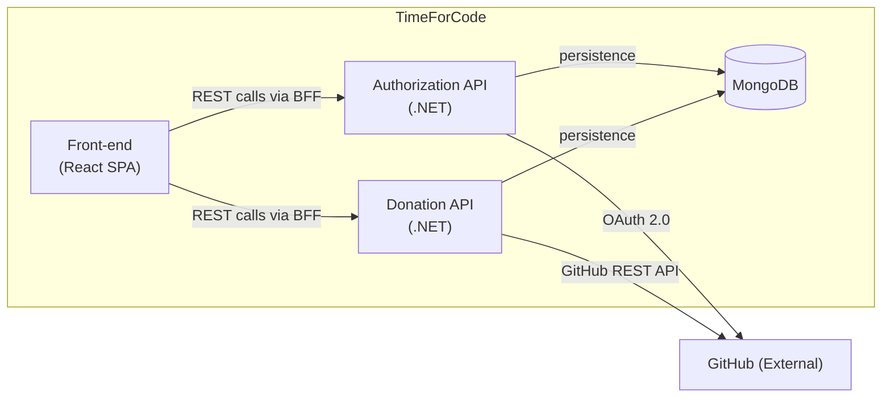
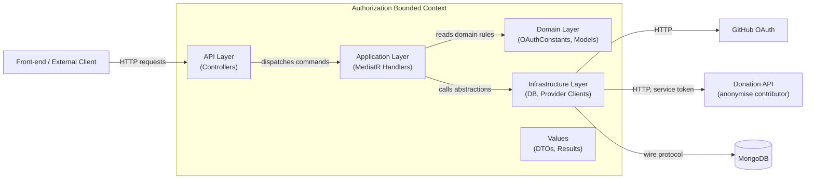
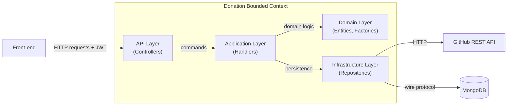

# Arc42 Section 5 — Building Block View

Status: Mixed

This section describes the static decomposition of the system into building blocks and their responsibilities.

Published views of the [LikeC4 architecture model](../likec4/README.md): [containers](https://wouterfennis.github.io/TimeForCode/architecture-model/#/view/containers/), [front-end](https://wouterfennis.github.io/TimeForCode/architecture-model/#/view/frontend/), [Authorization](https://wouterfennis.github.io/TimeForCode/architecture-model/#/view/authorization/), [Donation](https://wouterfennis.github.io/TimeForCode/architecture-model/#/view/donation/) and [Shared](https://wouterfennis.github.io/TimeForCode/architecture-model/#/view/shared/); per layer [Authorization API](https://wouterfennis.github.io/TimeForCode/architecture-model/#/view/authorizationApi/), [Authorization Application](https://wouterfennis.github.io/TimeForCode/architecture-model/#/view/authorizationApplication/), [Authorization Infrastructure](https://wouterfennis.github.io/TimeForCode/architecture-model/#/view/authorizationInfrastructure/), [Donation API](https://wouterfennis.github.io/TimeForCode/architecture-model/#/view/donationApi/), [Donation Application](https://wouterfennis.github.io/TimeForCode/architecture-model/#/view/donationApplication/), [Donation Domain](https://wouterfennis.github.io/TimeForCode/architecture-model/#/view/donationDomain/) and [Donation Infrastructure](https://wouterfennis.github.io/TimeForCode/architecture-model/#/view/donationInfrastructure/).

---

## Level 1 — System Overview

At the highest level, TimeForCode consists of three deployable services and a shared data store.

---

## Level 2 — Authorization Bounded Context

The Authorization context handles all concerns related to user identity, token issuance, and session management.

### Components

| Component | Responsibility |
| --- | --- |
| `TimeForCode.Authorization.Api` | REST endpoints: login, callback, refresh, logout, user (profile, repositories, account deletion), JWKS |
| `TimeForCode.Authorization.Application` | MediatR command handlers; token service; account linking |
| `TimeForCode.Authorization.Domain` | OAuth constants and domain primitives |
| `TimeForCode.Authorization.Infrastructure` | GitHub OAuth client; Donation API client (account deletion); MongoDB user and token repositories; RSA key loading |
| `TimeForCode.Authorization.Commands` | MediatR command and result types |
| `TimeForCode.Authorization.Values` | Shared value objects (ExternalAccessToken, TokenResult) |
| `TimeForCode.Authorization.Api.Client` | Typed HTTP client for the Authorization API, generated from its OpenAPI document; used by the specification tests |

---

## Level 2 — Donation Bounded Context

The Donation context manages all concerns related to projects, donations, hour tracking, and organisations.

### Components

| Component | Responsibility |
| --- | --- |
| `TimeForCode.Donation.Api` | REST endpoints for project registration, search and listing, detail, and the review lifecycle (submit, approve, request changes, archive, re-activate; policies `ApiUser` and `ApiAdmin`); donor-organization creation, listing, detail, update, and deletion; logging and listing project contributions; pledging hours to a project, listing donations and activating or cancelling them (policies `ApiUser` and `ApiUserOrAdmin`) |
| `TimeForCode.Donation.Application` | MediatR command handlers; GitHub metadata fetch interface |
| `TimeForCode.Donation.Domain` | Project entity with lifecycle state machine (Draft, PendingApproval, Active, Archived); GithubSnapshot record; DocumentEntity base class |
| `TimeForCode.Donation.Infrastructure` | MongoDB project repository (including `ProjectSearchDefinitions`: the active-project search filter and the status, language and topic indexes created at startup); GitHub public REST API client |
| `TimeForCode.Donation.Commands` | MediatR command, query, and result types |
| `TimeForCode.Donation.Values` | Shared value objects (ProjectStatus and DonationStatus enums) |
| `TimeForCode.Donation.Api.Client` | Typed HTTP client for the Donation API, generated from its OpenAPI document; used by the specification tests |

### Domain Entities

| Entity | Responsibility |
| --- | --- |
| `Project` | Registered open-source project; linked to a GitHub repository |
| `Donation` | Own MongoDB document: hours pledged to a project by a donor organization or an individual (never both) with the lifecycle Pending, Active, Completed, Cancelled; counts hours logged on its project while Active and completes itself when they reach the commitment |
| `DonorOrganization` | Company registered as a donor |
| `Contributor` | Developer who logs hours; own MongoDB document, upserted by platform user id (unique index) on every logged contribution; also holds the profile (role, normalised skills, hours available, optional `DonorOrganizationId`, indexed), changed only through `UpdateProfile` and the profile endpoints |
| `Contribution` | Time-log entry of a contributor on an `Active` project; stores the `ContributorId` plus a snapshot of the GitHub login and avatar (extended reference, like `GithubSnapshot` on `Project`); the entity enforces the hour and GitHub-reference limits itself and decides who may change it: `Correct` and `MarkDeleted` return a `ContributionChange` (the changed contribution and the hours delta, or the refusal `Deleted`/`NotAllowed`); saves are version-checked (`Version`, a concurrent change is a conflict); a correction keeps the replaced hours and reference in `History` (with corrector and time), a deletion only sets `DeletedAt`/`DeletedByUserId` and reads exclude deleted contributions; `DonationAllocation.PlanRelease` decides which allocations give hours back; `DonationHoursCounter` (shared with logging) counts hours toward Active donations and `DonationHoursReleaser` takes released hours back from the donation allocations (donation saved first, then the allocation shrinks or is removed) |
| `Maintainer` | Developer who owns projects; own MongoDB document, upserted by platform user id (unique index) when a project is registered, with a snapshot of the GitHub login and avatar. Projects link to it through `PublishedByUserId` (indexed); owner-only project operations compare that field with the caller's platform user id, so the maintainer document is not read for ownership checks |
| `Milestone` | Phase within a project, synced from GitHub milestones |

---

## Level 2 — Front-end

The front-end is a React single-page application written in TypeScript and built with Vite (`src/Frontend/TimeForCode.Frontend`). It is the user-facing shell and contains no business logic. It reaches the Authorization API and the Donation API through a same-origin backend-for-frontend (BFF) that turns the `HttpOnly` token cookies into bearer tokens (target state, [ADR-012](../../reference/adr/0012-react-spa-frontend.md)). Stack, folder layout and testing strategy: [front-end architecture](../../frontend/architecture.md).

| Folder | Responsibility |
| --- | --- |
| `src/app` | Application shell, routing and providers |
| `src/components` | Design-system components |
| `src/features` | One folder per feature with its pages, queries and tests |
| `src/messages` | All user-facing strings |
| `src/api` | Clients generated from the OpenAPI snapshots (target state) |
| `tests` | Shared test setup and helpers, including the axe accessibility check |

Component tests run with Vitest, Testing Library and axe. Interactive and informational elements get `data-testid` attributes, so the browser-level Playwright acceptance tests can select them independently of the markup.

---

## Level 2 — Shared

| Component | Responsibility |
| --- | --- |
| `TimeForCode.Shared` | `CookieAuthorizationHandler` reads the JWT cookie and attaches it as a bearer token on outgoing HTTP calls. `AuthorizeFilter` validates the token on incoming requests. |
