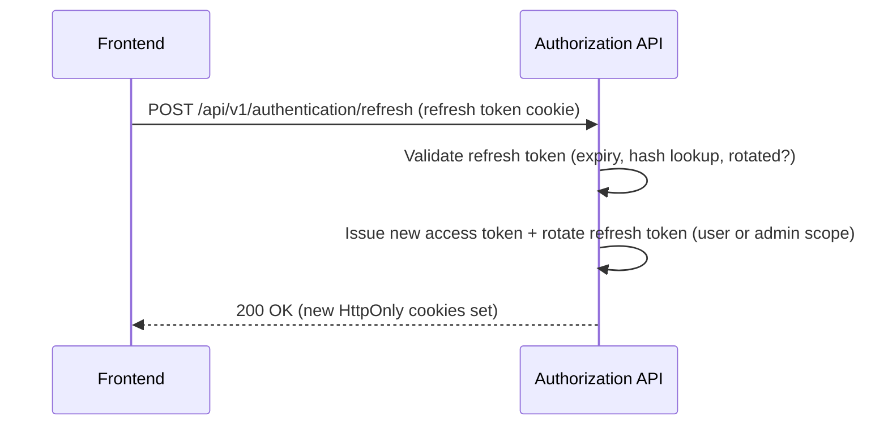
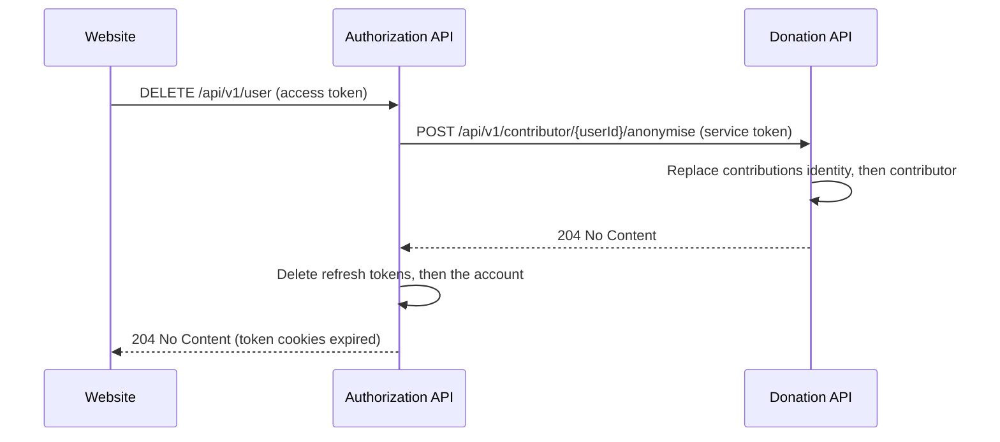
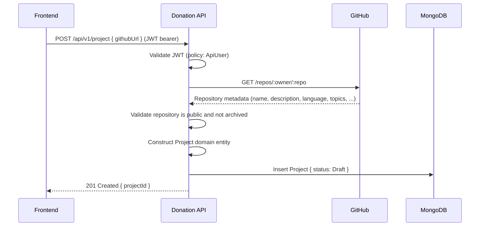
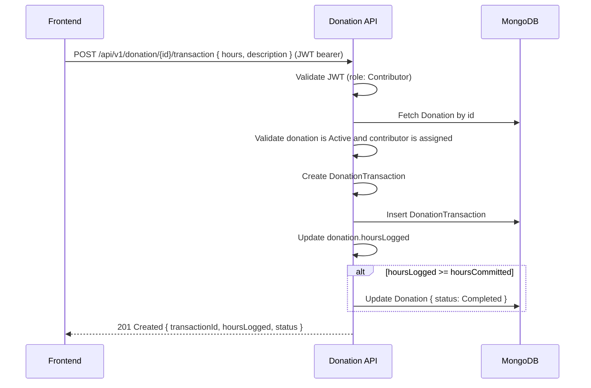

# Arc42 Section 6 — Runtime View

Status: Mixed

This section describes the most important runtime scenarios — how the building blocks interact at execution time.

Published views of the [LikeC4 architecture model](../likec4/README.md): [GitHub login](https://wouterfennis.github.io/TimeForCode/architecture-model/#/view/githubLogin/) and [logging a time contribution](https://wouterfennis.github.io/TimeForCode/architecture-model/#/view/logContribution/).

---

## Scenario 1 — User Login via GitHub OAuth 2.0

This is the current, fully implemented authentication flow. See [authentication flow design](../../authentication/authentication_flow_design.md) for the complete step-by-step description.

```mermaid
sequenceDiagram
    participant Browser
    participant Frontend
    participant AuthAPI as Authorization API
    participant GitHub

    Browser->>Frontend: GET / (unauthenticated)
    Frontend-->>Browser: Login page
    Browser->>Frontend: Click "Sign in with GitHub"
    Frontend->>AuthAPI: GET /api/v1/authentication/login
    AuthAPI-->>Browser: 302 Redirect to GitHub (with state, client_id; no scope, so public profile access only)
    Browser->>GitHub: GET /login/oauth/authorize
    GitHub-->>Browser: GitHub login & consent page
    Browser->>GitHub: User approves
    GitHub-->>AuthAPI: GET /api/v1/authentication/callback?code=...&state=...
    AuthAPI->>GitHub: POST /login/oauth/access_token (exchange code)
    GitHub-->>AuthAPI: External access token
    AuthAPI->>GitHub: GET /user (fetch profile)
    GitHub-->>AuthAPI: User profile (id, login, email)
    AuthAPI->>AuthAPI: Discard the GitHub token; link GitHub account to internal user
    AuthAPI->>AuthAPI: Issue internal JWT + refresh token
    AuthAPI-->>Browser: 302 Redirect to Frontend (set HttpOnly cookies)
    Browser->>Frontend: GET / (authenticated, JWT cookie present)
```

---

## Scenario 2 — Token Refresh

When the access token expires, the Frontend obtains a new one transparently.



The Frontend does not need to re-direct the user; the `CookieAuthorizationHandler` in the Shared layer intercepts 401 responses and triggers the refresh automatically.

---

## Scenario 2b — Delete Account

A signed-in user removes the account and personal data. The Donation API goes first, so its failure leaves everything in place and the user can retry.



When the Donation API fails, the Authorization API answers 502 and removes nothing. See [personal data](../../reference/personal-data.md).

---

## Scenario 3 — Register a Project



---

## Scenario 3b — Review a Project

A maintainer submits a `Draft` project for review (`POST /api/v1/project/{id}/submit`, user JWT, owner only). An administrator, authenticated with an admin JWT (scope `admin`), then approves it (`POST .../approve`, project becomes `Active` and appears in the public list) or sends it back (`POST .../request-changes` with a reason, project returns to `Draft` and the reason is stored). Maintainers can archive an `Active` project (`.../archive`) and re-activate an `Archived` one (`.../reactivate`). The `Project` aggregate rejects every other transition; the API answers `409 Conflict`. A non-admin calling an admin endpoint gets `403`, an anonymous caller `401`.

## Scenario 3c — Search Active Projects

A visitor calls `GET /api/v1/project` without authentication, optionally with `searchText`, `language`, `tag`, `pageNumber` and `pageSize`. The controller rejects a `pageNumber` below 1 or a `pageSize` outside 1 to 100 with `400` problem details. Otherwise `GetProjectsHandler` trims the criteria, treats blank values as absent, lower-cases the tag and calls `IProjectRepository.SearchActiveAsync`. The MongoDB repository builds one filter (`Active` status AND the supplied criteria), counts the matches and returns the requested page sorted by `PublishedAt` descending, then `_id` descending. The response carries the page and the total match count. Contract: [api-surface.md](../../current/api-surface.md#project-search).

## Scenario 3d — Pledge hours and track a donation

A signed-in user calls `POST /api/v1/project/{id}/donation` with the hours and exactly one donor (individual or donor organization). `PledgeDonationHandler` loads the project, rejects it with `409` unless it is `Active`, checks the donor organization (`404` when unknown) and stores a `Pending` donation. The donor or an administrator calls `POST /api/v1/donation/{id}/activate` or `/cancel`; the entity enforces the transitions (`409` otherwise). When anyone logs hours via `POST /api/v1/project/{id}/contribution`, `AddContributionHandler` also counts them toward the project's `Active` donations, oldest first; a donation that reaches its committed hours becomes `Completed`. Contract: [api-surface.md](../../current/api-surface.md#donation-endpoints).

## Scenario 3d1 — Correct or delete a contribution

The contributor who logged hours, or an administrator, calls `PUT` or `DELETE /api/v1/project/{id}/contribution/{contributionId}` with a user or admin token. `CorrectContributionHandler` or `DeleteContributionHandler` loads the contribution (deleted ones are not returned, so they answer `404`) and its contributor, then asks the `Contribution` entity to change itself. The entity refuses a deleted contribution and a caller who is neither the contributor nor an administrator (`404` and `403`), otherwise returns the changed contribution and the difference in hours. A correction keeps the replaced hours and reference in the history, a deletion only marks the contribution as deleted. The repository saves only the version that was loaded, so a concurrent change answers `409`. Afterwards the hours difference is applied to the donations: extra hours are counted by `DonationHoursCounter` like when logging, removed hours are taken back by `DonationHoursReleaser`, newest allocation first, saving each donation before its allocation shrinks or is removed. A `Completed` donation that falls below its commitment becomes `Active` again. The steps are separate writes (see RISK-05).

## Scenario 3d2 — Maintainer profile and own projects

`RegisterProjectHandler` stores the new `Draft` project and then upserts the `Maintainer` of the caller from the token's platform user id, `login` and `avatar_url` claims, so a further project reuses the same document. `GET /api/v1/maintainer/me` returns that document (`404` before the first project). `GET /api/v1/maintainer/me/projects` makes `GetMyProjectsHandler` load the caller's projects by `PublishedByUserId` in any state and the `Active` and `Completed` donations of those projects in one query, and adds the committed hours per project as `hoursDonated`. Owner-only operations compare `PublishedByUserId` with the caller and answer `403` otherwise. Contract: [api-surface.md](../../current/api-surface.md#maintainer-endpoints).

## Scenario 3e — Maintain a contributor profile

A signed-in user calls `PUT /api/v1/contributor/me` with role, skills, hours available and an optional donor organization. The API enforces the size limits as validation attributes (`400`); `UpdateContributorProfileHandler` loads the caller's contributor, or registers one from the token claims when logging hours never created it, checks that a linked donor organization exists (`404` otherwise), lets `Contributor.UpdateProfile` normalise the skills and saves only the profile fields, so the identity snapshot and the logged hours stay untouched. `GET` and `PUT /api/v1/contributor/{id}` apply the same rules to a profile by id and answer `403` unless the caller owns it or is an administrator; administrators list a donor organization's contributors with `GET /api/v1/donororganization/{id}/contributor`. Contract: [api-surface.md](../../current/api-surface.md#contributor-endpoints).

## Scenario 4 — Log Hours Against a Donation (Target)


