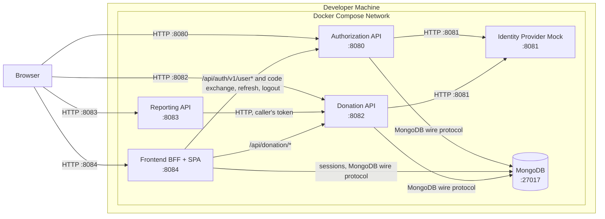
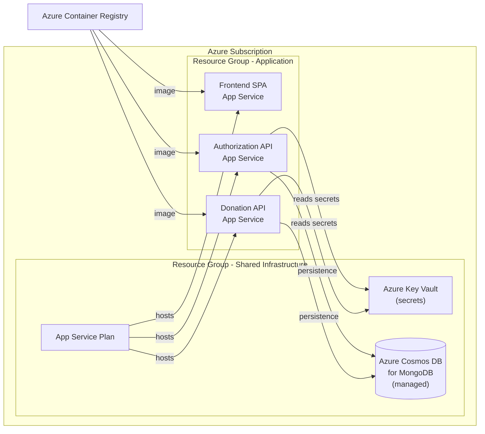

# Arc42 Section 7 - Deployment View

Status: Mixed

This section describes how the system is deployed in its target and current environments.

Published views of the [LikeC4 architecture model](../likec4/README.md): [production deployment](https://wouterfennis.github.io/TimeForCode/architecture-model/#/view/production/), [local development](https://wouterfennis.github.io/TimeForCode/architecture-model/#/view/local/), [target production deployment](https://wouterfennis.github.io/TimeForCode/architecture-model/#/view/target/) and the [delivery pipeline](https://wouterfennis.github.io/TimeForCode/architecture-model/#/view/delivery/).

---

## Local Development

All services run in Docker containers orchestrated by Docker Compose. The Identity Provider Mock replaces GitHub for local OAuth flows.



To start:

```powershell
podman compose up --build
```

---

## Target Cloud Deployment (Azure)

No cloud deployment definition exists at present; it is being rewritten. The full platform should eventually run on Azure with each service as an independent App Service container, a managed MongoDB instance, and secrets stored in Azure Key Vault.



### Target Infrastructure Requirements

| Component | Technology | Notes |
| --- | --- | --- |
| Frontend | Azure App Service (container) | The BFF serving the SPA, holding the browser session (MongoDB) and forwarding the API routes (one container, `Dockerfile.frontend`) |
| Authorization API | Azure App Service (container) | Not yet deployed |
| Donation API | Azure App Service (container) | Not yet deployed |
| Reporting API | Azure App Service (container) | Not yet deployed; needs the Donation API address (`DonationApiOptions__BaseUri`), the token settings and its own MongoDB database (`DbOptions__ConnectionString`, `DbOptions__DatabaseName`) for badge tiers and awards |
| Database | Azure Cosmos DB for MongoDB API | Drop-in replacement for MongoDB driver |
| Secrets | Azure Key Vault | Client secrets, RSA key, connection strings |
| Container registry | Azure Container Registry | Build and store images via CI/CD |
| TLS | Azure App Service managed certificates | Automatic HTTPS |

---

## Environment Summary

| Environment | Services | Notes |
| --- | --- | --- |
| Local (`docker-compose`) | All services + IdP Mock + MongoDB | Dev only; HTTP; uses mock identity provider |
| Target Production | All services | Deployment definition not yet written |
