# Authentication flow

How a person signs in, how the browser stays signed in, and how every API call gets its token. The design is decided in [ADR-019](../reference/adr/0019-browser-session-in-the-bff.md) (the browser session lives in the BFF) and builds on [ADR-001](../reference/adr/0001-use-internal-jwt.md) (internal JWT), [ADR-011](../reference/adr/0011-webauthn-admin-authentication.md) (admin passkey), [ADR-013](../reference/adr/0013-no-stored-github-tokens.md) (no stored GitHub tokens), [ADR-015](../reference/adr/0015-durable-single-use-login-state.md) (durable single-use state) and [ADR-018](../reference/adr/0018-reporting-reads-donation-over-http-with-forwarded-token.md) (Reporting forwards the caller's token). [ADR-005](../reference/adr/0005-http-only-cookies.md) (tokens in cookies) is superseded.

Two readers:

- **In five minutes:** read [In short](#in-short), the [overview diagram](#overview) and the [credential table](#every-cookie-token-and-code).
- **Engineer or front-end developer:** the [sequence diagrams](#sequence-diagrams) have the detail, the [front-end guide](#front-end-guide) has the endpoints and example requests.

Status: implemented as described, for the GitHub sign-in and the admin passkey login (registration and sign-in through the BFF).

## In short

- The browser talks only to the **BFF** (the host that serves the SPA, `src/Frontend/TimeForCode.Frontend.Bff`). It holds **one opaque cookie**, `__Host-session`. No token is in a cookie, a response body, the URL or anything a script can read.
- The BFF keeps the access and refresh token **server-side** in MongoDB, adds `Authorization: Bearer ...` to every call it forwards to the APIs, and refreshes an expired token itself.
- The **Authorization API** is a plain token issuer for every client. For the GitHub sign-in it sets and reads no cookie. It hands out tokens only against a **single-use code plus the PKCE verifier** of the client that started the login.
- The **Donation, Reporting and Authorization APIs** only ever see bearer tokens. Reporting forwards the caller's own token to the Donation API.
- An XSS bug can still make the browser call the API with the session cookie attached (session riding). The design prevents token theft, not that; see [Decisions and accepted risk](#decisions-and-accepted-risk).

## Overview

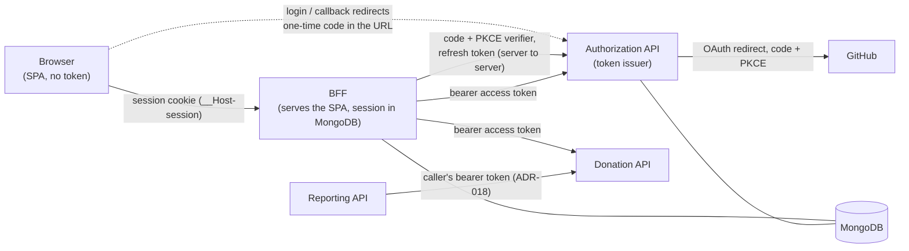

Only the arrows labelled with a credential carry one. The browser never receives a token; the dotted arrow is the sign-in redirect, which carries a one-time code that is worthless without the verifier the BFF holds.

## Every cookie, token and code

| Credential | Issued by | Stored by | Lifetime | Flags and format | Who can read it |
| --- | --- | --- | --- | --- | --- |
| Session cookie `__Host-session` | BFF | Browser (the cookie); BFF database holds the hash of its id | Browser session; server-side idle timeout 30 minutes (`Session:IdleTimeoutMinutes`), absolute 8 hours (`Session:AbsoluteLifetimeHours`) | `HttpOnly`, `Secure`, `SameSite=Strict`, `Path=/`, no `Domain`; random 256-bit id, no content | Sent by the browser to the BFF only; script cannot read it |
| Login cookie `__Host-login` | BFF | Browser; BFF database holds the hash of its id and the PKCE verifier | 10 minutes (`Session:LoginTimeoutMinutes`), removed at the callback | `HttpOnly`, `Secure`, `SameSite=Lax` (the browser returns from another site), `Path=/`; random id | BFF only |
| PKCE verifier (BFF to Authorization API) | BFF, per login | BFF database (never in the browser) | Until the callback, at most 10 minutes | 43 to 128 unreserved characters | BFF only; only its S256 challenge goes into the login URL |
| One-time code | Authorization API | MongoDB (hash only) | 60 seconds (`AuthenticationOptions:LoginCodeLifetimeInSeconds`), single use | Random string in the callback redirect `?code=` | Visible in the URL of one redirect (browser history, logs); useless without the verifier |
| Access token (JWT, RS256) | Authorization API | BFF database (inside the session) | 1 to 15 minutes (`TokenCreationOptions:TokenExpiresInMinutes`) | `Authorization: Bearer` between the BFF and the APIs | BFF and the APIs; never the browser |
| Refresh token | Authorization API | BFF database (session); Authorization API stores only its SHA-256 hash | 7 days (`DefaultRefreshTokenExpirationAfterInDays`), single use: every refresh rotates it | Random string in a request body between the BFF and the Authorization API | BFF and Authorization API; never the browser |
| GitHub access token | GitHub | Nowhere | Used once to read the profile, then dropped | Bearer, Authorization API to GitHub | Authorization API, for one call |

## Sequence diagrams

### GitHub sign-in with the PKCE binding and one-time code exchange

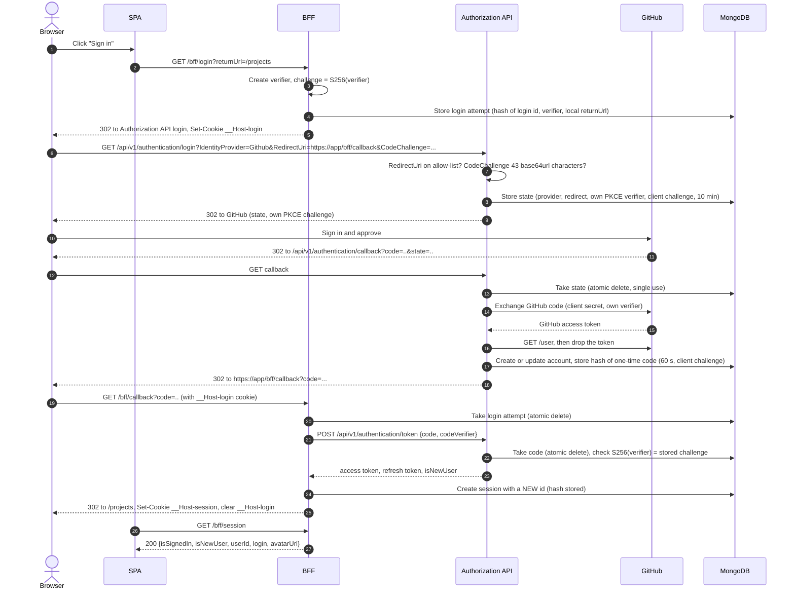

What each step guarantees:

- **Steps 4 and 9 to 11 bind the login to the browser.** The verifier never leaves the BFF and the login id only maps to it in the cookie of the browser that started the login. An attacker who starts a login, signs in as themselves and sends the callback URL to a victim fails: the victim's browser has no matching `__Host-login` cookie (login CSRF is closed).
- **The code is useless alone.** Without the verifier the exchange returns `400`, and the lookup consumed the code, so a guess cannot be retried. A replayed, forged or expired code gets the same `400`.
- **Failure cases.** Any failure at the callback sends the browser to `/?signInError=1` and creates no session. The Authorization API answers `400` with `ProblemDetails` for a bad redirect URI, an invalid challenge, an unknown or used `state` or an invalid code.
- **No token in any redirect, cookie or body** the browser sees.

### An authenticated API call through the BFF

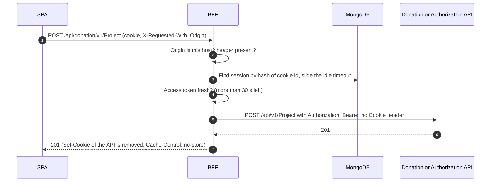

The BFF strips the browser's `Cookie` and `Authorization` headers before it forwards, so the APIs never see a cookie and a script cannot supply its own token. A request without a session is forwarded without a bearer header and the API decides (public endpoints answer, protected ones answer `401`). Only `/api/donation/...` and `/api/auth/v1/user...` are routed; every other path under `/api/auth/` is `404`.

### Silent refresh with the per-session refresh lock

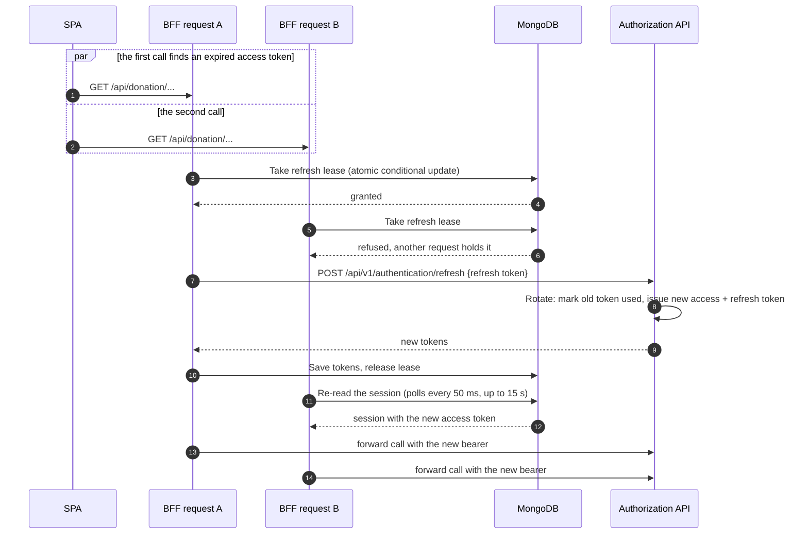

A refresh token may be used once. The Authorization API treats a second use as theft and revokes every refresh token of the user, so two requests must never refresh with the same token. The lease is one atomic conditional update on the session record (`RefreshLeaseUntil`, 30 seconds; waiting requests give up after 15 seconds), so it holds across BFF instances and expires on its own if the BFF dies mid-refresh. The SPA notices nothing. If the Authorization API cannot be reached, the call goes out without a bearer header and the session is kept; if it rejects the refresh token, the session ends (next diagram).

### An expired or revoked session

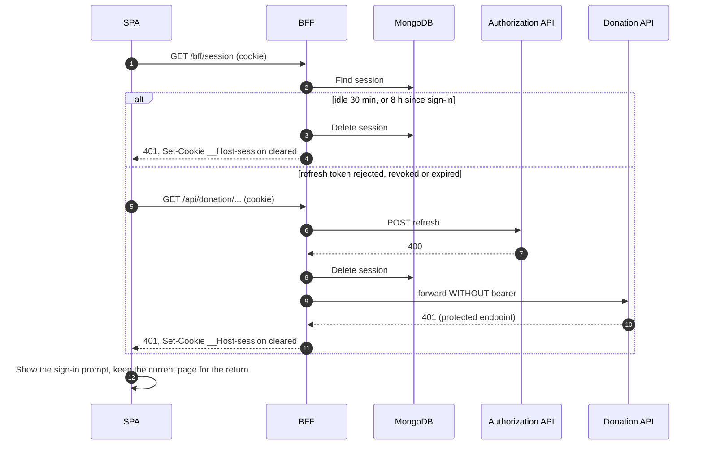

### Replayed refresh token (all tokens revoked)

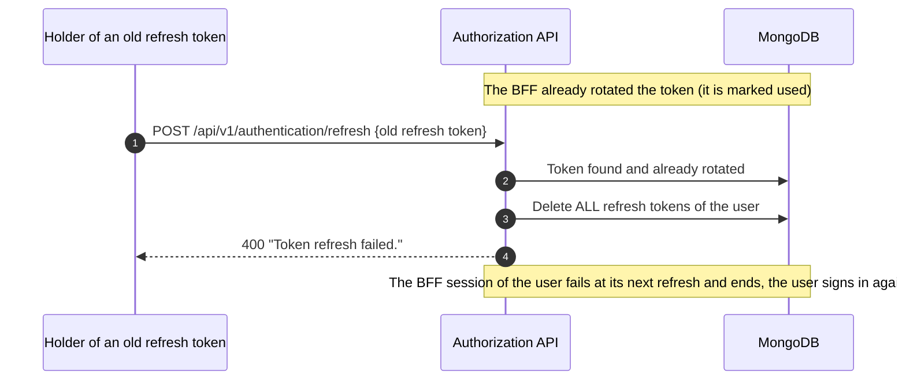

### Sign-out

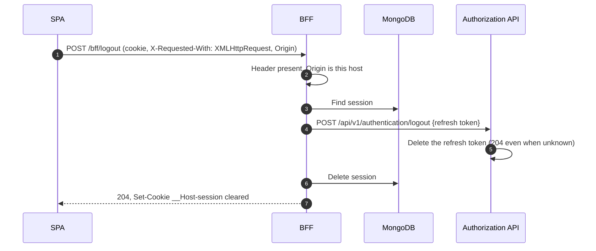

A missing header or a foreign `Origin` is `403` and nothing changes. A failure to reach the Authorization API does not keep the user signed in: the session is deleted anyway. Sign-out ends one session and revokes its refresh token; an access token that was already issued stays valid until it expires (at most 15 minutes). "Sign out everywhere" is out of scope.

### Reporting's forwarded-token call

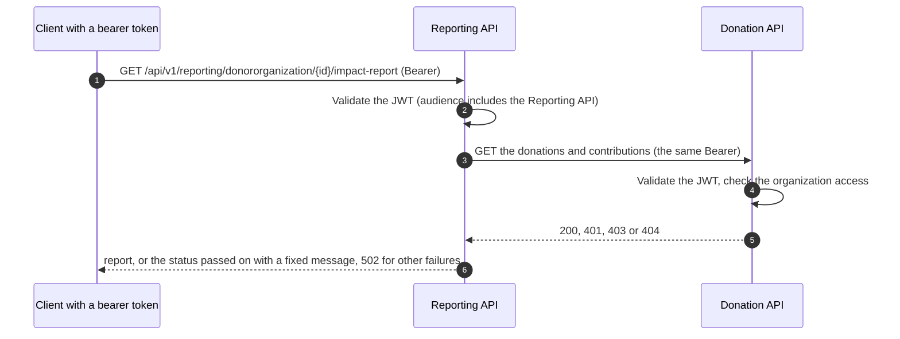

The Donation API alone decides who may read; Reporting has no service credential. The BFF is not on this path today; a browser reaches Reporting through the same bearer-adding mechanism when a route is added.

### Admin passkey registration and sign-in through the BFF

The administrator signs in with a WebAuthn passkey ([ADR-011](../reference/adr/0011-webauthn-admin-authentication.md), amended by #196). The role is claimed once, by registering a passkey with the bootstrap secret; after that the admin signs in with that passkey. Both ceremonies run through the BFF, set no cookie at the Authorization API and end in the same opaque `__Host-session` cookie as every other sign-in.

What is different from the GitHub sign-in:

- **A ceremony is a server-side record that works once.** The options call stores the (encrypted) challenge state under the hash of an opaque *ceremony id*, with the kind (registration or authentication) and an expiry (`AdminPasskeyOptions:CeremonyLifetimeInSeconds`, default 300). The completing call sends the id back; the record is taken with one atomic delete. There is no ceremony cookie.
- **Tokens go to the BFF only.** The Authorization API returns the admin access and refresh token in the body; the BFF keeps them in the session, and the browser gets `{ isSignedIn, isNewUser, isAdmin, userId, ... }` and the cookie.
- **Refusals carry no reason.** The BFF answers `400` with the same text whether the secret was wrong, the role was already claimed, the device is not the registered one or the ceremony was used.

#### Registration (first claim of the admin role)

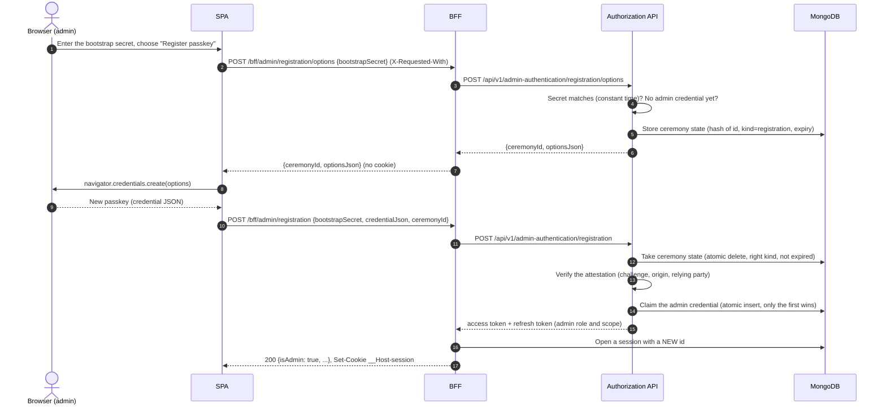

Failure cases: a wrong secret or an already claimed role stops the options call (`400`, nothing stored). A ceremony id that is unknown, expired, already used or of the other kind, or an attestation that does not verify, ends in `400` with no session. Two devices that register at the same moment: the atomic insert lets exactly one claim the role.

#### Sign-in

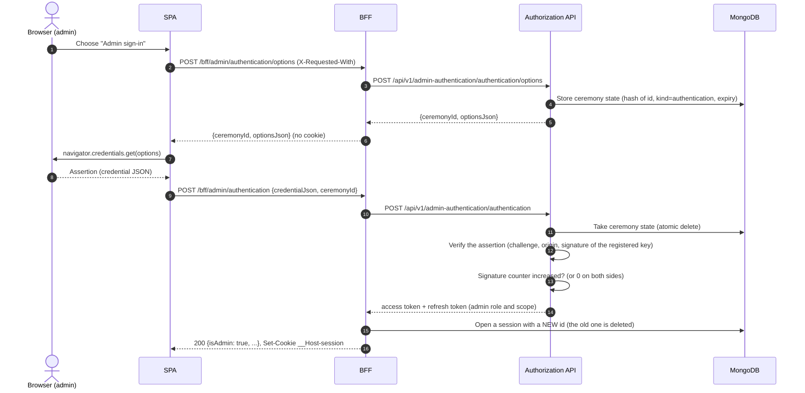

#### A replayed assertion

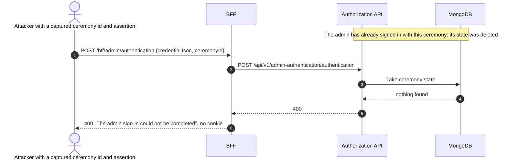

Two more defences against a copied or cloned credential:

- **The ceremony state is gone** after its first use, whatever the outcome, and expires after five minutes anyway. Also a ceremony that was started for a registration cannot complete a sign-in.
- **The signature counter must increase.** The stored counter is compared with the one in the assertion; an assertion with a counter that is equal or lower is refused (a cloned authenticator or a replay). Authenticators that keep no counter (synced passkeys) report 0 every time; 0 on both sides is accepted, so for those the single-use ceremony is the protection.

The ASP.NET Core passkey library verifies the cryptographic parts of the ceremony (challenge, origin, relying party, signature); the single-use state and the counter rule are enforced by the platform on top of it and covered by tests (`CeremonyStateStoreTests`, `CompleteAdminAuthenticationHandlerTests`, the admin specifications and `AdminEndpointsTests` of the BFF).

After sign-in the admin session is an ordinary session: calls get the bearer token, the access token is refreshed silently (the refresh works for the admin user id too), and sign-out is `POST /bff/logout`.

## Front-end guide

For the developer of the SPA. The SPA is served by the BFF, so all calls are same-origin.

### The rules

- Call **relative paths on your own origin**: `/api/donation/...`, `/api/auth/v1/user...`, `/bff/...`. Never call the Authorization API directly and never put an absolute API address in the code.
- **Never read, store or send a token.** There is none to read. Do not look at cookies (`__Host-session` is `HttpOnly`), do not add an `Authorization` header (the BFF removes it) and do not use `localStorage` or `sessionStorage` for credentials.
- Send **`X-Requested-With: XMLHttpRequest`** on every `POST`, `PUT`, `PATCH` and `DELETE`. Without it the BFF answers `403` and the request never reaches the API.
- Use `credentials: 'same-origin'` (the default of `fetch` for same-origin requests).

### Sign in and sign out

Sign in by sending the browser to the BFF; it is a navigation, not a `fetch`:

```text
GET /bff/login?returnUrl=%2Fprojects%2F42
```

`returnUrl` must be a path on this site (`/projects/42`); anything else becomes `/`. The browser goes through the identity provider and returns to `returnUrl` with the session cookie set. If the sign-in fails, the browser lands on `/?signInError=1`.

Sign out with a `POST`:

```ts
await fetch('/bff/logout', {
  method: 'POST',
  credentials: 'same-origin',
  headers: { 'X-Requested-With': 'XMLHttpRequest' },
}) // 204
```

`src/features/auth/session.ts` has `signInUrl`, `signOut` and `fetchSession`; `SessionControls` shows the controls.

### Find out whether the user is signed in

```ts
const response = await fetch('/bff/session', { headers: { Accept: 'application/json' } })
```

| Status | Meaning |
| --- | --- |
| `200` | Signed in. Body: `{ "isSignedIn": true, "isNewUser": false, "userId": "...", "login": "octocat", "avatarUrl": "https://..." }`. No token. |
| `401` | Not signed in, or the session expired or ended. Show the sign-in prompt. |
| other | The check failed; do not treat it as signed out. Show an error and retry. |

The response is never cached (`Cache-Control: no-store`). Call it when the app loads and after a sign-out. The BFF documents it in its OpenAPI document (`src/Frontend/TimeForCode.Frontend.Bff/TimeForCode.Frontend.Bff.json`).

### The first-login signal

`isNewUser` is `true` in `/bff/session` for 5 minutes after the first sign-in of a new account (`Session:NewUserMinutes`). Use it to show the welcome once; do not rely on it later.

### Errors to handle

| Status | Cause | What to do |
| --- | --- | --- |
| `401` | No session, session ended, or the API refused the token | Go to `signInUrl(current path)`; the user returns to the same page |
| `403` from the BFF | The `X-Requested-With` header is missing, or the `Origin` is another site | A bug in the client: add the header; never retry blindly |
| `403` from an API | The user lacks the role or access (for example an organization they are not part of) | Show "not allowed"; signing in again does not help |
| `429` | Rate limit; `Retry-After` gives seconds | Wait and retry once, then tell the user |
| `ProblemDetails` | `application/problem+json` with `title`, `detail`, and for validation `errors` | Show `detail`; map `errors` onto form fields |
| `502` | An API behind the BFF failed (Reporting maps Donation failures to it) | Show an error; try again later |

Example of the sign-in return after a `401`:

```ts
if (response.status === 401) {
  window.location.assign(signInUrl(`${window.location.pathname}${window.location.search}`))
}
```

### Admin sign-in (passkey)

The module `src/features/admin/passkey.ts` has `signInAdmin()` and `registerAdminPasskey(bootstrapSecret)`. Both talk only to `/bff/admin/...`, with the `X-Requested-With` header, and both return a status: `signed-in` (with the session info, `isAdmin: true`), `refused` (no reason is given: wrong secret, role already claimed, wrong device, used ceremony), `cancelled` (the user dismissed the browser prompt), `unsupported` (no `PublicKeyCredential`) or `error` (network or server failure). A refusal is not retried automatically: the ceremony works once, so the next attempt starts a new one.

What the SPA does and sends:

```ts
// 1. Ask for the options. The ceremony id works once and expires after five minutes.
const started = await fetch('/bff/admin/authentication/options', {
  method: 'POST',
  credentials: 'same-origin',
  headers: { 'Content-Type': 'application/json', 'X-Requested-With': 'XMLHttpRequest' },
  body: '{}',
}) // 200 { ceremonyId, optionsJson } | 400 (no passkey registered yet)
const { ceremonyId, optionsJson } = await started.json()

// 2. Let the browser sign. The WebAuthn JSON helpers do the base64url conversion.
const options = PublicKeyCredential.parseRequestOptionsFromJSON(JSON.parse(optionsJson))
const credential = (await navigator.credentials.get({ publicKey: options })) as PublicKeyCredential

// 3. Send the assertion and the ceremony id back. The response is the session info, never a token.
const finished = await fetch('/bff/admin/authentication', {
  method: 'POST',
  credentials: 'same-origin',
  headers: { 'Content-Type': 'application/json', 'X-Requested-With': 'XMLHttpRequest' },
  body: JSON.stringify({ ceremonyId, credentialJson: JSON.stringify(credential.toJSON()) }),
}) // 200 { isSignedIn, isNewUser, isAdmin, userId, login, avatarUrl } + Set-Cookie __Host-session | 400
```

Registration is the same with `/bff/admin/registration/options` (body `{ bootstrapSecret }`), `navigator.credentials.create` with `parseCreationOptionsFromJSON`, and `/bff/admin/registration` (body `{ bootstrapSecret, ceremonyId, credentialJson }`). The bootstrap secret is typed by the person doing the first claim: never store it, never log it. Do not call the Authorization API (`/api/v1/admin-authentication/...`) from the SPA: through the BFF those paths are `404`.

The passkey belongs to the relying party domain `AdminPasskeyOptions:ServerDomain`, which must be the host of the front-end. Where the admin signs in is up to the page (a button on the home page or a route); after sign-in `GET /bff/session` reports `isAdmin: true`, which the UI may use to show admin pages. The backend remains the enforcer: admin endpoints check the `admin` scope of the bearer token.

### Tabs and reloads

The session is a cookie, so it is shared by all tabs of the browser and survives reloads. Signing out in one tab ends it for all tabs; the other tabs find out at their next call (`401`). The idle timeout (30 minutes) slides forward with every call; after 8 hours the user has to sign in again however active they are.

### Run it locally

| What | Where |
| --- | --- |
| Whole stack | `scripts/start-local.ps1` (add `-ResetData` after a breaking change) |
| BFF and SPA | `http://localhost:8084` |
| Authorization API (login, callback) | `http://localhost:8080` (the browser is redirected here during sign-in) |
| Identity provider mock | `http://localhost:8081` |
| Vite dev server | `npm run dev` in `src/Frontend/TimeForCode.Frontend`; it proxies `/api/donation/` to `:8082` and `/bff` to the BFF on `:8084` |

The cookies are `Secure` and have the `__Host-` prefix. Chrome and Firefox accept `Secure` cookies on `http://localhost`. **Safari does not**, so sign-in does not work on `http://localhost` in Safari; use Chrome or Firefox or serve the stack over HTTPS. The compose stack allows the redirect URI `http://localhost:8084/bff/callback`; another origin must be added to `AuthenticationOptions:ValidRedirectUris`.

## The Authorization API for other clients

A client that is not the BFF (a script, a test, another service) uses the same endpoints, with its own PKCE pair:

| Endpoint | Purpose |
| --- | --- |
| `GET /api/v1/authentication/login?IdentityProvider=Github&RedirectUri=...&CodeChallenge=...` | Starts the login; `302` to GitHub. `CodeChallenge` is the unpadded base64url SHA-256 of a random verifier (43 characters). `RedirectUri` must be on the allow-list. |
| `GET /api/v1/authentication/callback` | Called by GitHub's redirect; `302` to the redirect URI with `?code=` |
| `POST /api/v1/authentication/token` | `{ "code": "...", "codeVerifier": "..." }` returns `{ accessToken, refreshToken, isNewUser }` |
| `POST /api/v1/authentication/refresh` | `{ "refreshToken": { "token": "...", "expiresAfter": "..." } }` returns new tokens; the sent token is now invalid |
| `POST /api/v1/authentication/logout` | Same body; revokes the refresh token, `204` |
| `POST /api/v1/admin-authentication/registration/options`, `.../registration`, `.../authentication/options`, `.../authentication` | The admin passkey ceremonies: the options calls return `{ ceremonyId, optionsJson }`, the completing calls take the `ceremonyId` and the credential JSON and return the tokens in the body (see [Admin passkey registration and sign-in](#admin-passkey-registration-and-sign-in-through-the-bff)) |
| `GET /.well-known/openid-configuration`, `GET /.well-known/jwks.json` | Discovery (issuer and JWKS location) and the public signing key |

`login`, `callback`, `token` and `refresh` use the sliding-window rate limit policy `auth`; the admin endpoints use `admin-auth`. The `token`, `refresh` and `logout` endpoints are meant for the BFF and other server-side clients; keep them off the public network where the deployment allows it. They need no secret, because the credential is the single-use code with its verifier, or the refresh token itself.

## Step by step: the Authorization API

### 1. Starting the login

The client calls `login` with the identity provider (GitHub), a `redirectUri` and a PKCE `codeChallenge`.

- The `redirectUri` must match an entry in `AuthenticationOptions:ValidRedirectUris`. The match compares scheme, host, port, path (ignoring a trailing slash), query and fragment; anything else is answered with `400` and a `ProblemDetails` body. This is the guard against open redirects, because the same URL is used for the final redirect.
- The `codeChallenge` must be 43 base64url characters; anything else is `400`.
- The handler creates a random `state` string and stores a `StateEntry` (state key, identity provider, return URL, its own PKCE verifier for GitHub, the client's challenge, expiry) in MongoDB, so any instance can complete the login. A TTL index removes entries 10 minutes after the login started.
- It then builds the GitHub authorize URL with `client_id`, `redirect_uri` (the Authorization API's own callback URL from `ExternalIdentityProviderOptions:CallbackUri`), `state`, and its own PKCE `code_challenge` (S256), and answers `302`.
- **No `scope` is requested.** GitHub then grants access to public profile data only (see [ADR-013](../reference/adr/0013-no-stored-github-tokens.md)).

### 2. The callback and the identity provider code exchange

GitHub redirects the browser to `callback` with a one-time `code` and the original `state` ([RFC 6749 section 4.1.2](https://datatracker.ietf.org/doc/html/rfc6749#section-4.1.2)). The access token request ([section 4.1.3](https://datatracker.ietf.org/doc/html/rfc6749#section-4.1.3)) follows:

1. `code` and `state` must both be non-empty and at most 2048 characters.
2. The `state` is taken from MongoDB: read and deleted in one atomic step, so it works once. An unknown, already used or expired `state` fails the request, which stops forged or replayed callbacks.
3. The API calls GitHub's token endpoint server to server with `client_id`, `client_secret`, `code`, `redirect_uri` and its own `code_verifier`. The client secret never reaches the browser.
4. GitHub answers with an access token. The browser never sees it.

Any failure is logged with the provider's message, but the client only receives `400` with the generic text "Authentication failed.".

### 3. Reading the profile and dropping the GitHub token

The GitHub token is used for exactly one call: `GET /user`. The response is mapped to an `AccountInformation` (provider account id, login, node id, avatar, name, company, email, bio, location). After that call the token goes out of scope. It is not written to MongoDB, not logged and not put in a cookie. Public repository data is read later with the application's own client id and secret ([ADR-013](../reference/adr/0013-no-stored-github-tokens.md)).

### 4. Linking to an internal account

The account is looked up by the provider's account id. If it is not found, a new account is created and the user is marked as new (`isNewUser`). If it is found, the stored profile is updated. The internal account id (a MongoDB `ObjectId`) becomes the `sub` claim and does not change when the GitHub login changes.

### 5. The one-time code and the token exchange

The callback does not issue tokens. It stores a `LoginCode` (SHA-256 hash of a random code, user id, `isNewUser`, the client's challenge, expiry after 60 seconds) and redirects to the stored `redirectUri` with `?code=`. At `token` the code is **taken with an atomic delete**; it is expired after 60 seconds, and `S256(codeVerifier)` must equal the stored challenge (compared in constant time). Any mismatch is `400` "Code exchange failed.", and the code is already gone. Only then are the tokens issued:

**Access token.** A JWT signed with RS256 using the Authorization API's RSA key.

| Claim | Value |
| --- | --- |
| `iss` | `TokenCreationOptions:Issuer` |
| `aud` | `TokenCreationOptions:Audiences` (list) |
| `sub` | Internal account id |
| `scope` | `user` for GitHub logins, `admin` for the admin passkey login |
| `login`, `avatar_url` | GitHub login and avatar (user tokens only) |
| `role` | `admin` (admin tokens only) |
| `nbf`, `exp` | Now and now plus `TokenExpiresInMinutes` (1 to 15) |

**Refresh token.** A random string; MongoDB stores its SHA-256 hash with the user id and expiry (`DefaultRefreshTokenExpirationAfterInDays`).

### 6. Validation at the resource servers

A resource server such as the Donation API validates the bearer token locally: it fetches the signing key from the issuer's `/.well-known/jwks.json` (via `Authority`), checks signature, issuer, audience and lifetime, and the endpoint's policy checks the `scope` claim (`ApiUser` requires `scope=user`, `ApiAdmin` requires `scope=admin`). No call to the Authorization API is needed per request, so a token stays valid until it expires, even after sign-out. That is why its lifetime is at most 15 minutes.

### 7. Refreshing and revoking

`refresh` takes the refresh token in the body:

1. The token must exist in MongoDB and not be expired, and the account must still exist.
2. It is marked rotated with one atomic conditional update; the loser of a concurrent rotation counts as a replay.
3. A new access token is issued from the current account data and a new refresh token is created.
4. Using an already rotated token deletes **all** refresh tokens of the user ("Refresh token reuse detected").

Missing, unknown, expired and replayed tokens all end in `400` "Token refresh failed.". `logout` deletes the presented refresh token and answers `204`.

## Security properties

| Concern | How it is handled |
| --- | --- |
| Token theft by script | No token reaches the browser: tokens live in the BFF database; the browser holds one opaque `HttpOnly` cookie |
| Login CSRF (attacker's account) | The PKCE verifier stays at the BFF and is tied to the `__Host-login` cookie of the browser that started the login |
| Forged or replayed callback | `state` must exist, is consumed on first use and expires after 10 minutes |
| Stolen or guessed one-time code | Hash only in the database, 60 seconds, single use, useless without the verifier, consumed even by a wrong verifier |
| Authorization code interception at GitHub | PKCE toward GitHub, and the client secret stays on the server |
| Open redirect | The return URL must match the configured allow-list before the login starts |
| Session fixation | A new session id is created at every sign-in |
| CSRF on state-changing calls | `SameSite=Strict`, the `X-Requested-With` header and an `Origin` check |
| Refresh token replay | Rotation with an atomic update; reuse revokes all tokens of the user |
| Refresh race inside the BFF | A lease on the session record lets one request refresh; the others wait |
| Cookies and tokens on the APIs | The BFF removes `Cookie` and `Authorization` from the browser's request and `Set-Cookie` from the response |
| Token endpoints reachable by script | Only the user endpoints of the Authorization API are routed through the BFF |
| Secrets in logs | The BFF and the APIs log no cookie, token, code or session id (a test scans the log output) |
| Information leakage | Clients get generic error texts; log values are stripped of control characters |
| Brute force | Sliding-window rate limits on login, callback, token, refresh and the admin endpoints |
| Replayed admin assertion or ceremony | The ceremony state is a server-side record taken with one atomic delete, expires after five minutes, and the signature counter must increase |
| Transport | HSTS behind a trusted proxy, `Secure` cookies, forwarded headers only from configured proxies ([chapter 8](../architecture/arc42/08-crosscutting-concepts.md#transport-and-browser-security-headers)) |

## Decisions and accepted risk

- **Why the BFF holds the session** and why MongoDB stores it: [ADR-019](../reference/adr/0019-browser-session-in-the-bff.md). It replaces tokens in cookies ([ADR-005](../reference/adr/0005-http-only-cookies.md)).
- **Accepted risk: session riding.** A script that runs on the SPA origin (an XSS bug) can call `/api/...` with the session cookie attached. A BFF prevents token theft, not that. Mitigations: a CSP without `unsafe-inline` and `unsafe-eval`, the `Origin` and `X-Requested-With` checks, and the idle and absolute timeouts.
- **Accepted risk: tokens at rest** in the BFF database in the clear; they expire within 15 minutes (access) or are revoked at sign-out (refresh).
- **Known limitations.** The signing key is not rotated automatically (the JWKS endpoint publishes the current and previous key). Access tokens cannot be revoked before they expire. The email may be missing because no scope is requested. Sign out everywhere is not offered.

## Configuration reference

| Section | Setting | Meaning |
| --- | --- | --- |
| `AuthenticationOptions` | `ValidRedirectUris` | Allow-list for return URLs; contains the BFF callback, for example `https://app/bff/callback` |
| `AuthenticationOptions` | `LoginCodeLifetimeInSeconds` | Lifetime of the one-time code, default 60 |
| `AdminPasskeyOptions` | `ServerDomain`, `RelyingPartyName`, `BootstrapSecret` | The relying party of the passkey (the front-end host) and the secret that allows the one-time claim of the admin role |
| `AdminPasskeyOptions` | `CeremonyLifetimeInSeconds` | How long a passkey ceremony can be completed, default 300; the state works once |
| `AuthenticationOptions` | `Issuer`, `Audience` | Values the Authorization API itself validates tokens against |
| `TokenCreationOptions` | `Issuer`, `Audiences` | Values written into issued tokens |
| `TokenCreationOptions` | `TokenExpiresInMinutes`, `DefaultRefreshTokenExpirationAfterInDays` | Token lifetimes; the access token lifetime must be 1 to 15 minutes or the service does not start |
| `ForwardedHeaders` | `KnownProxies`, `KnownNetworks` | The proxies whose `X-Forwarded-*` headers are trusted; without them only loopback is (all services, BFF included) |
| `ExternalIdentityProviderOptions` | `CallbackUri` and per provider hosts, `ClientId`, `ClientSecret` | The OAuth app registration at GitHub |
| BFF `Authorization` | `BaseAddress`, `PublicBaseAddress` | Where the BFF calls the token endpoints (internal) and where the browser is sent to log in (public) |
| BFF `Session` | `IdleTimeoutMinutes`, `AbsoluteLifetimeHours`, `RefreshSkewSeconds`, `LoginTimeoutMinutes`, `NewUserMinutes` | Session timeouts and the refresh margin; defaults 30, 8, 30, 10 and 5 |
| BFF `DbOptions` | `ConnectionString`, `DatabaseName` | The MongoDB database of the sessions |

Secrets belong in environment-specific configuration, never in the repository.

## References

| Topic | Specification |
| --- | --- |
| Authorization code grant, `state`, redirect URIs, token endpoint | [RFC 6749 — The OAuth 2.0 Authorization Framework](https://datatracker.ietf.org/doc/html/rfc6749) |
| Sending the access token as `Authorization: Bearer` | [RFC 6750 — Bearer Token Usage](https://datatracker.ietf.org/doc/html/rfc6750) |
| Current security recommendations (exact redirect URI matching, `state`, refresh token rotation) | [RFC 9700 — OAuth 2.0 Security Best Current Practice](https://datatracker.ietf.org/doc/html/rfc9700) |
| Internal access token format and claims | [RFC 7519 — JSON Web Token](https://datatracker.ietf.org/doc/html/rfc7519) |
| Public signing key published at `jwks.json` | [RFC 7517 — JSON Web Key](https://datatracker.ietf.org/doc/html/rfc7517) |
| Discovery document at `openid-configuration` | [OpenID Connect Discovery 1.0](https://openid.net/specs/openid-connect-discovery-1_0.html) |
| The code challenge and verifier | [RFC 7636 — PKCE](https://datatracker.ietf.org/doc/html/rfc7636) |
| Cookie prefixes (`__Host-`) and `SameSite` | [RFC 6265bis — Cookies](https://datatracker.ietf.org/doc/html/draft-ietf-httpbis-rfc6265bis) |
| GitHub's own behaviour (endpoints, scopes, rate limits) | [Authorizing OAuth apps](https://docs.github.com/en/apps/oauth-apps/building-oauth-apps/authorizing-oauth-apps) |
| Admin login | [W3C Web Authentication](https://www.w3.org/TR/webauthn-3/) |

The discovery document only carries `issuer` and `jwks_uri`, a minimal subset of the OpenID Connect format; the platform does not implement OpenID Connect login itself.
