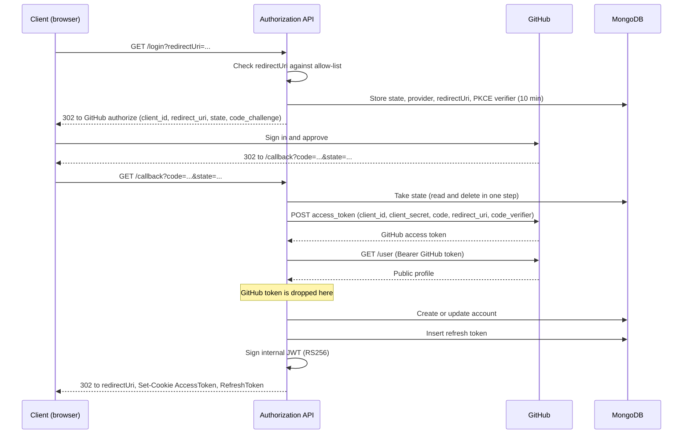

# Authentication flow

This document explains in depth how a person signs in, how the GitHub authorization code is exchanged for a token, and how the platform turns that into its own session. It describes the implemented behaviour of the Authorization module (`src/Authorization/`). For the short version see [arc42 section 6](../architecture/arc42/06-runtime-view.md); for the reasoning behind the main choices see [ADR-001](../reference/adr/0001-use-internal-jwt.md), [ADR-005](../reference/adr/0005-http-only-cookies.md), [ADR-011](../reference/adr/0011-webauthn-admin-authentication.md) and [ADR-013](../reference/adr/0013-no-stored-github-tokens.md).

## In short

1. The client asks the Authorization API to start a login and names the URL to return to.
2. The API checks that URL against an allow-list, stores a random `state` and redirects the browser to GitHub.
3. GitHub redirects back to the API with an authorization `code` and the same `state`.
4. The API exchanges the code for a GitHub access token (server to server), reads the public profile and **discards the GitHub token**.
5. The API links the GitHub account to an internal account, creating it on first login.
6. The API issues its own signed JWT and a refresh token, sets both as cookies and redirects the browser to the return URL.
7. Other services accept the JWT after verifying its signature against the keys published by the Authorization API.

Two kinds of token are involved and they never mix:

| Token | Issued by | Lifetime | What it is for | Stored |
| --- | --- | --- | --- | --- |
| GitHub access token | GitHub | Does not expire | Reading the signed-in user's profile once | Nowhere: discarded after the profile fetch |
| Internal access token (JWT) | Authorization API | `TokenExpiresInMinutes` (configuration) | Calling the platform APIs | Only in the client's cookie |
| Internal refresh token | Authorization API | `DefaultRefreshTokenExpirationAfterInDays` (configuration) | Getting a new access token without GitHub | MongoDB, and in the client's cookie |

The login is the OAuth 2.0 *authorization code grant* ([RFC 6749 section 4.1](https://datatracker.ietf.org/doc/html/rfc6749#section-4.1)), with the Authorization API acting as the confidential client and GitHub as the authorization server. See [References](#references) for the specifications.

## Participants and endpoints

| Participant | Role |
| --- | --- |
| Client (browser or SPA) | Starts the login, follows redirects, holds the cookies |
| Authorization API | OAuth client towards GitHub and token issuer towards the platform |
| GitHub | External identity provider (OAuth app) |
| Donation API and other APIs | Resource servers that validate the internal JWT |

| Endpoint | Purpose |
| --- | --- |
| `GET /api/v1/authentication/login` | Starts the login; answers with a redirect to GitHub |
| `GET /api/v1/authentication/callback` | Receives GitHub's redirect, performs the code exchange, issues tokens |
| `GET /api/v1/authentication/refresh` | Issues a new access token and rotates the refresh token |
| `GET /api/v1/authentication/logout` | Deletes the refresh token |
| `GET /.well-known/openid-configuration` | Discovery document (issuer and JWKS location) |
| `GET /.well-known/jwks.json` | Public signing key |

`login`, `callback` and `refresh` use the sliding-window rate limit policy `auth`.

## Sequence

## Step by step

### 1. Starting the login

The client calls `login` with the identity provider (GitHub) and a `redirectUri`, the place the user should end up after signing in.

- The `redirectUri` must match an entry in `AuthenticationOptions:ValidRedirectUris`. The match compares scheme, host, port, path (ignoring a trailing slash), query and fragment; anything else is answered with `400` and a `ProblemDetails` body. This is the guard against open redirects, because the same URL is used for the final redirect.
- The handler creates a random `state` string and stores a `StateEntry` (state key, identity provider, return URL, PKCE code verifier, expiry) in MongoDB, so any instance can complete the login. A TTL index removes entries after the expiry, 10 minutes after the login started.
- It then builds the GitHub authorize URL with `client_id`, `redirect_uri` (the Authorization API's own callback URL from `ExternalIdentityProviderOptions:CallbackUri`), `state`, and the PKCE `code_challenge` (SHA-256 of the verifier, `code_challenge_method=S256`), and answers `302`.
- **No `scope` is requested.** GitHub then grants access to public profile data only (see [ADR-013](../reference/adr/0013-no-stored-github-tokens.md)).

### 2. The callback and the code exchange

GitHub redirects the browser to `callback` with a one-time `code` and the original `state` (authorization response, [RFC 6749 section 4.1.2](https://datatracker.ietf.org/doc/html/rfc6749#section-4.1.2)). This is where the *token exchange* happens (access token request, [section 4.1.3](https://datatracker.ietf.org/doc/html/rfc6749#section-4.1.3)):

1. The request is validated: `code` and `state` must both be non-empty.
2. The `state` is taken from MongoDB: read and deleted in one atomic step, so it works once. An unknown, already used or expired `state` fails the request, which stops forged or replayed callbacks. The expiry is checked in the handler because the TTL index removes entries with a delay of up to a minute. The stored entry also tells the API which identity provider to use.
3. The API calls GitHub's token endpoint server to server with a JSON `POST` containing `client_id`, `client_secret`, `code`, `redirect_uri` and the stored `code_verifier`. The client secret never reaches the browser.
4. GitHub answers with an access token. The browser never sees it.

Any failure in these steps is logged with the provider's message, but the client only receives `400` with the generic text "Authentication failed." so provider details do not leak.

### 3. Reading the profile and dropping the GitHub token

The GitHub token is used for exactly one call: `GET /user` with `Authorization: Bearer <token>`. The response is mapped to an `AccountInformation` (provider account id, login, node id, avatar, name, company, email, bio, location).

After that call the token goes out of scope. It is not written to MongoDB, not logged and not put in a cookie. The platform has no GitHub token to leak and no GitHub credential to revoke.

Public repository data (the user's repositories, a single repository) is read later with the application's own client id and secret, sent as HTTP Basic and only over HTTPS. See [ADR-013](../reference/adr/0013-no-stored-github-tokens.md).

### 4. Linking to an internal account

The account is looked up by the provider's account id:

- **Not found:** a new account is created and the response marks the user as new (`IsNewUser`).
- **Found:** the stored profile is updated from the fresh GitHub data.

The internal account id (a MongoDB `ObjectId`) becomes the `sub` claim. It does not change when the GitHub login changes.

### 5. Issuing the internal tokens

**Access token.** A JWT signed with RS256 using the Authorization API's RSA key.

| Claim | Value |
| --- | --- |
| `iss` | `TokenCreationOptions:Issuer` |
| `aud` | `TokenCreationOptions:Audiences` (list) |
| `sub` | Internal account id |
| `scope` | `user` for GitHub logins, `admin` for the admin passkey login |
| `login`, `avatar_url` | GitHub login and avatar (user tokens only) |
| `role` | `admin` (admin tokens only) |
| `nbf`, `exp` | Now and now plus `TokenExpiresInMinutes` |

**Refresh token.** A random string, stored in MongoDB together with the user id and its expiry (`DefaultRefreshTokenExpirationAfterInDays`).

### 6. Cookies and the final redirect

The tokens are returned as cookies and the browser is redirected to the stored return URL (when the state carries none, the endpoint answers `200` with the tokens in the body instead).

| Cookie | Content | Flags |
| --- | --- | --- |
| `AccessToken` | JSON `{ token, expiresAfter }` | `HttpOnly`, `Secure`, `SameSite=Strict`, expires with the token |
| `RefreshToken` | JSON `{ token, expiresAfter }` | `HttpOnly`, `Secure`, `SameSite=Strict`, expires with the token |
| `IsNewUser` | `true` | Same flags, lives 5 minutes, only set on first login |

Script code cannot read these cookies. Because the cookie holds JSON rather than the bare JWT, whatever forwards it as a bearer header (see below) must unpack the `token` field.

### 7. Using the access token

A client or backend-for-frontend reads the `AccessToken` cookie and sends the `token` value as `Authorization: Bearer <jwt>` (`CookieAuthorizationHandler` does this).

A resource server such as the Donation API validates the token locally:

1. It fetches the signing key from the issuer's `/.well-known/jwks.json` (via `Authority`) and caches it.
2. It checks signature, issuer, audience and lifetime.
3. The endpoint's authorization policy checks the `scope` claim: `ApiUser` requires `scope=user`, `ApiAdmin` requires `scope=admin`.

No call to the Authorization API is needed per request, so a token stays valid until it expires, even after logout.

### 8. Refreshing

When the access token has expired the client calls `refresh`, which reads the `RefreshToken` cookie:

1. The refresh token must exist in MongoDB and not be expired, and the account it belongs to must still exist.
2. A new access token is issued from the current account data.
3. The old refresh token is **deleted** and a new one is created (rotation), so a refresh token works once.
4. New cookies are set and the new tokens are also returned in the body.

Missing cookie, unknown token, expired token or unknown account all end in `400` "Token refresh failed.", after which the client sends the user through the login again.

### 9. Logging out

`logout` deletes the refresh token from MongoDB and answers `204`. It does not clear the cookies and cannot revoke an access token that was already issued; that token stays valid until `exp`, which is why its lifetime is short.

## Admin login

Administrators do not use GitHub. They sign in with a WebAuthn passkey (`/api/v1/admin-authentication/...`, rate limit policy `admin-auth`, see [ADR-011](../reference/adr/0011-webauthn-admin-authentication.md)). After a successful assertion the same `TokenService` issues a token with `sub=admin`, `role=admin` and `scope=admin`, plus a refresh token. There is no GitHub token exchange in this path.

## Security properties

| Concern | How it is handled |
| --- | --- |
| Forged or replayed callback | `state` must exist in the database, is consumed on first use and expires after 10 minutes |
| Authorization code interception | PKCE: GitHub only accepts the code together with the verifier that never left the server |
| Open redirect | The return URL must match the configured allow-list before the login starts |
| Authorization code theft | The code is only useful together with the client secret, which stays on the server |
| Stolen database | No GitHub token is stored; the refresh token is a random value that expires |
| Token theft from script | Cookies are `HttpOnly`, `Secure` and `SameSite=Strict` |
| Refresh token replay | Rotation: every use deletes the old token |
| Information leakage | Clients get generic error texts; log values are stripped of control characters |
| Brute force | Sliding-window rate limits on the login, callback, refresh and admin endpoints |

## Known limitations

- **The signing key is not rotated.** The JWKS endpoint publishes one key without a key id.
- **Access tokens cannot be revoked** before they expire.
- **Email may be missing.** Only the public GitHub email is available since no scope is requested.

## Configuration reference

| Section | Setting | Meaning |
| --- | --- | --- |
| `AuthenticationOptions` | `ValidRedirectUris` | Allow-list for return URLs |
| `AuthenticationOptions` | `Issuer`, `Audience` | Values the Authorization API itself validates tokens against |
| `TokenCreationOptions` | `Issuer`, `Audiences` | Values written into issued tokens |
| `TokenCreationOptions` | `TokenExpiresInMinutes`, `DefaultRefreshTokenExpirationAfterInDays` | Token lifetimes |
| `ExternalIdentityProviderOptions` | `CallbackUri` and per provider hosts, `ClientId`, `ClientSecret` | The OAuth app registration at GitHub |

Secrets belong in environment-specific configuration, never in the repository.

## References

| Topic | Specification |
| --- | --- |
| Authorization code grant, `state`, redirect URIs, token endpoint | [RFC 6749 — The OAuth 2.0 Authorization Framework](https://datatracker.ietf.org/doc/html/rfc6749) |
| Sending the access token as `Authorization: Bearer` | [RFC 6750 — Bearer Token Usage](https://datatracker.ietf.org/doc/html/rfc6750) |
| Current security recommendations (exact redirect URI matching, `state`, refresh token rotation) | [RFC 9700 — OAuth 2.0 Security Best Current Practice](https://datatracker.ietf.org/doc/html/rfc9700) |
| Internal access token format and claims (`iss`, `aud`, `sub`, `exp`, `nbf`) | [RFC 7519 — JSON Web Token](https://datatracker.ietf.org/doc/html/rfc7519) |
| Public signing key published at `jwks.json` | [RFC 7517 — JSON Web Key](https://datatracker.ietf.org/doc/html/rfc7517) |
| Discovery document at `openid-configuration` | [OpenID Connect Discovery 1.0](https://openid.net/specs/openid-connect-discovery-1_0.html) |
| Protecting the code with a verifier | [RFC 7636 — PKCE](https://datatracker.ietf.org/doc/html/rfc7636) |
| GitHub's own behaviour (endpoints, scopes, rate limits) | [Authorizing OAuth apps](https://docs.github.com/en/apps/oauth-apps/building-oauth-apps/authorizing-oauth-apps) |
| Admin login | [W3C Web Authentication](https://www.w3.org/TR/webauthn-3/) |

The discovery document only carries `issuer` and `jwks_uri`, so it is a minimal subset of the OpenID Connect format and the platform does not implement OpenID Connect login itself. The GitHub flow uses PKCE (S256) on top of the client secret and `state`, as RFC 9700 recommends.
