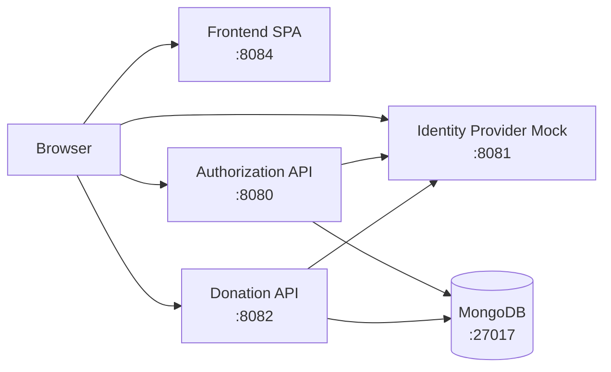

# Deployment Status

Status: Current

This document describes how the platform is deployed today, both locally and in the cloud.

---

## Local Development

The full platform runs locally via Podman and Docker Compose. The compose file at the repository root starts all services.

> **Why Podman?** Docker Desktop requires a paid licence in many organisations. Podman is a free, daemonless drop-in replacement. The `docker-compose.yaml` in this repository works with `podman compose` without modification.

**Windows first-time setup (once per machine):**

```powershell
podman machine init
podman machine start
```

**Start the stack:**

```powershell
podman compose up --build
```

**Smoke test:**

```powershell
.\scripts\smoke-test.ps1
```

The script is a smoke tier of 13 checks: service availability, OIDC discovery, the login round trip, the Auth API JWT accepted by the Donation API, one Mongo-backed write and read (register a project, read it back), the data protection key ring in the database, and the front-end (the SPA on `/` and on a deep link, the 404 for a missing asset, and the security headers on those responses). Project lifecycle, role checks and GitHub token handling are covered by the Reqnroll specifications. Each run leaves one new `Draft` project in the local database.

### Services and Ports



The Identity Provider Mock replaces GitHub in local development. The Authorization API is configured to direct OAuth 2.0 requests to the mock instead of `github.com`. The Donation API is configured to call the mock's `/repos/{owner}/{repo}` endpoint instead of `api.github.com` when fetching repository metadata on project publish.

| Service | URL | Notes |
| --- | --- | --- |
| Frontend (SPA) | <http://localhost:8084> | React SPA served by nginx; not yet wired to the APIs |
| Authorization API | <http://localhost:8080> | OAuth 2.0 + JWT |
| Identity Provider Mock | <http://localhost:8081> | Simulates GitHub OAuth and GitHub REST API |
| Donation API | <http://localhost:8082> | Project and donation management |
| MongoDB | mongodb://localhost:27017 | Shared database instance |

### Container port note

All .NET services in this stack listen on port **8080** inside the container (not the traditional 80). This is required because the containers run as a non-root user (`appuser`) under Podman rootless mode — ports below 1024 are privileged and unavailable to non-root processes. The host-to-container port mapping in `docker-compose.yaml` still exposes the familiar ports (8080–8084) on the host machine.

| Container | Internal port | Host port |
| --- | --- | --- |
| authorization-api | 8080 | 8080 |
| identity-provider-mock | 8080 | 8081 |
| donation-api | 8080 | 8082 |
| frontend | 8080 | 8084 |
| mongo | 27017 | 27017 |

### Configuration

All services are configured via environment variables defined in `docker-compose.yaml`. Key configuration points:

- **Token signing**: RSA key pair provided as a base64-encoded PKCS#12 certificate via `RsaOptions__Base64Certificate`; outside the Development environment the Authorization API refuses to start without it. Tokens carry a `kid` header derived from the public key. For key rotation, move the old certificate to `RsaOptions__PreviousBase64Certificate`: its public key stays in the JWKS so tokens signed with it remain valid until they expire, then remove it. Rotation is manual and the previous key is never expired automatically. Locally set `RSA_PREVIOUS_BASE64_CERTIFICATE` for compose; in Azure pass the secure Bicep parameter `previousSigningCertificate`. Without a certificate in Development the API generates a throwaway key at every start, so tokens do not survive a restart and instances do not share keys.
- **Token lifetime**: Access token expires in 60 minutes; refresh token in 7 days.
- **Redirect URIs**: The Authorization API validates redirect URIs against an allowlist.
- **Test-only admin access**: the Authorization API gets `TestAdminAccess__Enabled` and `TestAdminAccess__Secret` from `TEST_ADMIN_ACCESS_SECRET`. When that variable is unset (plain `podman compose up`) the feature stays disabled; `scripts/start-local.ps1` sets a random value. The Authorization API port is bound to `127.0.0.1`. The Azure deployment runs as `Production` and never sets these values.
- **Database**: Each service connects to MongoDB using a connection string from `DbOptions__ConnectionString`.

> Credentials and secrets in `docker-compose.yaml` are for local development only. Do not use them in any other environment.

---

## Cloud Deployment (Azure)

The production environment runs on Microsoft Azure using Azure App Service with container-based deployment.

### Infrastructure

```mermaid
graph LR
    subgraph Azure Subscription
        subgraph Resource Group — App
            AuthAppService["Authorization API\nApp Service"]
        end
        subgraph Resource Group — Infrastructure
            AppServicePlan["App Service Plan"]
        end
    end

    GitHub["GitHub Container Registry\nor ACR"] -->|container image| AuthAppService
    AppServicePlan --> AuthAppService
```

The infrastructure is defined as code using Azure Bicep templates in the `deploy/` folder.

| Template | Purpose |
| --- | --- |
| `deploy/application.bicep` | Top-level orchestration; references modules |
| `deploy/applicationInfrastructure.bicep` | Shared infrastructure (App Service Plan) |
| `deploy/modules/appService.bicep` | App Service definition and settings |
| `deploy/modules/appServicePlan.bicep` | App Service Plan definition |
| `deploy/modules/appServiceSidecar.bicep` | Sidecar container support |

### Deployment Region

- Primary region: West Europe.

### Known Gaps

| Gap | Notes |
| --- | --- |
| Donation API not deployed | Only the Authorization API is currently deployed to Azure |
| Frontend not deployed to Azure | Only runs locally |
| MongoDB managed service | Local compose uses a dev MongoDB; production database provisioning not yet defined in Bicep |
| No staging environment | Only production is defined |
| No secrets management | Secrets are passed as App Settings; Key Vault integration is not yet configured |

See [Arc42 Section 07 — Deployment View](../architecture/arc42/07-deployment-view.md) for the target deployment architecture.
