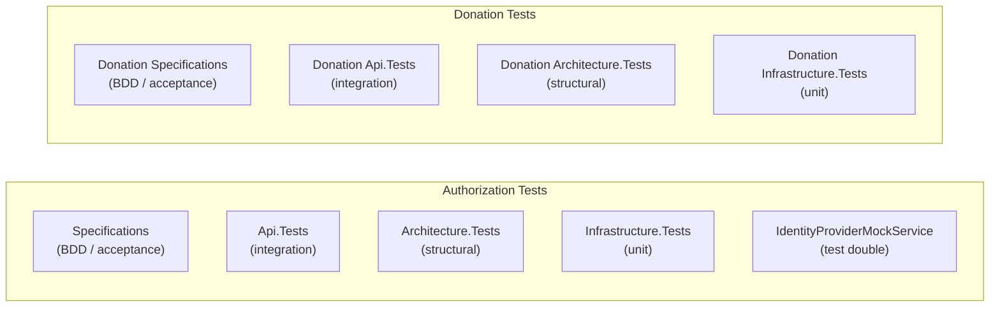

# Current Testing Strategy

Status: Current

This document describes the test projects that exist today and their scope.

---

## Test Projects

The test suite is split by bounded context and test type.



### Authorization — Specifications

**Path**: `tst/Authorization/TimeForCode.Authorization.Specifications`

BDD-style acceptance tests that describe the expected behaviour of the Authorization API from the outside. These tests cover the full authentication flow using the Identity Provider Mock as the external OAuth 2.0 provider.

The features run in parallel (`ExecutionScope.ClassLevel`, one test class per feature file). This is safe because every scenario builds its own host, cookie container, `SessionContext` and fakes.

### Authorization — Api.Tests

**Path**: `tst/Authorization/TimeForCode.Authorization.Api.Tests`

Integration tests that exercise the Authorization API endpoints directly.

### Authorization — Architecture.Tests

**Path**: `tst/Authorization/TimeForCode.Authorization.Architecture.Tests`

Structural tests that enforce the layering and dependency rules of the Authorization bounded context. These tests use [ArchUnitNET](https://archunitnet.readthedocs.io/) to verify that:

- Domain projects do not reference infrastructure.
- Infrastructure does not reference the API.
- Dependencies flow in one direction only.

#### Enforcement scope

All production assemblies in the Authorization bounded context are loaded before each test (via `[TestInitialize]`) in `ArchitectureTestBase`. Each rule is asserted with an `Evaluate(rule)` call that fails the test if any violation is found.

#### Example rules

```csharp
// Domain must not depend on the API layer
Types().That().Are(DomainLayer).Should()
    .NotDependOnAny(ApiLayer)
    .Because("Domain layer should not have references to other layers");

// Application must not depend on Infrastructure
Types().That().Are(ApplicationLayer).Should()
    .NotDependOnAny(InfrastructureLayer)
    .Because("Application layer should not have references to infrastructure layer");

// All MediatR request handlers must live in the Application layer
Types().That().ImplementInterface(typeof(IRequestHandler<>)).Should()
    .ResideInNamespaceMatching(".*\\.Authorization\\.Application\\..*")
    .Because("Command Handlers should always be in the application layer");
```

Adding a new rule is as simple as creating a new `[TestMethod]` in the appropriate test class (`DomainLayerTests`, `ApplicationLayerTests`, or `InfrastructureLayerTests`) and calling `Evaluate(rule)`.

### Authorization — Infrastructure.Tests

**Path**: `tst/Authorization/TimeForCode.Authorization.Infrastructure.Tests`

Unit tests for the Infrastructure layer, covering data access, token storage, and external provider clients.

### Identity Provider Mock Service

**Path**: `tst/Authorization/IdentityProviderMockService`

A lightweight ASP.NET Core application that simulates a GitHub OAuth 2.0 provider. Used during local development and integration tests to avoid requiring a real GitHub OAuth application.

The mock implements:

- `/login/oauth/authorize` — simulates the GitHub authorization redirect.
- `/login/oauth/access_token` — returns a test access token.
- `GET /user` — returns a stub GitHub user profile.
- `GET /user/repos` — returns a list of stub repositories.
- `GET /repos/{owner}/{repo}` — returns repository metadata for any owner/repo combination; used by the Donation API when registering a project locally.

### Donation — Specifications

**Path**: `tst/Donation/TimeForCode.Donation.Specifications`

BDD-style acceptance tests for the Donation API. Covers the full project lifecycle: publishing a repository, browsing the project listing, and unpublishing a project, plus pledging hours, the donation lifecycle (activate, cancel, automatic completion) and browsing donations with their progress (`Features/Donations`). Uses an in-memory donation repository next to a `WebApplicationFactory` with Moq and `MockHttp` to stub the MongoDB repositories and the GitHub API service.

The scenarios run sequentially: one shared host serves every scenario and is reset before each one, so parallel execution makes scenarios wipe each other's state (70 to 100 of 213 failed in a trial). The host clears the JwtBearer `Authority` so it does not try to load OpenID metadata from the Development stack; without that, every authenticated scenario took about 1.15 s on Windows.

### Donation — Api.Tests

**Path**: `tst/Donation/TimeForCode.Donation.Api.Tests`

Integration tests for the Donation API. Currently contains the Swagger snapshot test.

### Donation — Architecture.Tests

**Path**: `tst/Donation/TimeForCode.Donation.Architecture.Tests`

Structural tests that enforce the layering and dependency rules of the Donation bounded context, mirroring the Authorization Architecture.Tests. Uses [ArchUnitNET](https://archunitnet.readthedocs.io/) to verify that:

- Domain does not reference Application, Infrastructure, or the API.
- Application does not reference Infrastructure or the API.
- Infrastructure does not reference the API.
- All classes named `*Handler` reside in the Application layer.
- All classes named `*Repository` reside in the Infrastructure layer.

### Donation — Infrastructure.Tests

**Path**: `tst/Donation/TimeForCode.Donation.Infrastructure.Tests`

Unit tests for the Donation Infrastructure layer, covering:

- `GithubRepositoryApiService` — URL parsing (invalid host, wrong segment count), successful metadata mapping, and API error responses (404, 5xx).
- `ProjectRepository` — all CRUD operations including invalid `ObjectId` handling, empty-result paths, duplicate-key exception wrapping into `RepositoryConflictException`, and `GetByGithubUrlAsync`.

---

## Swagger Snapshot Tests — API Contract Gate

The `Api.Tests` project in both the Authorization and Donation bounded contexts contains a single snapshot test:

- `tst/Authorization/TimeForCode.Authorization.Api.Tests/SwaggerTests.cs`
- `tst/Donation/TimeForCode.Donation.Api.Tests/SwaggerTests.cs`

Each test reads the generated OpenAPI specification (`.json`) and uses the [Verify](https://github.com/VerifyTests/Verify) library to compare it against a committed `.verified.txt` snapshot. When the API surface changes, the test fails and writes a `.received.txt` diff file next to the snapshot.

### Purpose

This failure is **intentional and deliberate**. It is a review gate, not a test to be silenced. The intent is to force a conscious decision every time the public API contract changes.

### Review checklist

Before accepting a snapshot update, answer every question:

| # | Question | Why it matters |
| - | -------- | -------------- |
| 1 | Was this API surface change intentional, or is it a side-effect of an internal refactor? | Unintentional changes break callers silently. |
| 2 | Does the change remove or rename an existing field or endpoint? | Removals and renames are **breaking changes** for existing clients. |
| 3 | Should a new API version (e.g. `/v2/`) be introduced instead of modifying the existing one? | Breaking changes in a versioned API require a new version so existing callers are not broken. |
| 4 | If fields are added, can they be marked optional to preserve backward compatibility? | Optional new fields are non-breaking; required new fields are breaking. |
| 5 | Does the NSwag-generated client (`src/Authorization/TimeForCode.Authorization.Api.Client/`) need to be reviewed? | NSwag regenerates method names (e.g. `RepositoriesAsync` → `RepositoriesAllAsync`) when endpoints are added; callers of the generated client must be updated. |

If any answer reveals a breaking change, do not accept the snapshot silently. Decide on the appropriate response (versioning, optional fields, or explicit deprecation) before updating the snapshot.

### Accepting a snapshot update

Once the review is complete and the change is confirmed as intentional and safe:

```powershell
# Replace the committed snapshot with the newly generated one
Copy-Item `
  tst/<Module>/TimeForCode.<Module>.Api.Tests/SwaggerTests.Verify_GeneratedSwaggerFile_ShouldNotChangeUnlessIntended.received.txt `
  tst/<Module>/TimeForCode.<Module>.Api.Tests/SwaggerTests.Verify_GeneratedSwaggerFile_ShouldNotChangeUnlessIntended.verified.txt `
  -Force
```

Commit the updated `.verified.txt` alongside the code change that caused it, so the diff is reviewable in the pull request.

---

## Admin Actions on a Running Stack

Admin actions (approve, request changes) need an admin token, and the real admin login requires a WebAuthn passkey. On the local stack, `scripts/start-local.ps1` sets a random `TEST_ADMIN_ACCESS_SECRET` (or uses the one already in your environment, which must be at least 16 characters), and the compose file then enables the test-only admin endpoint:

```powershell
$env:TEST_ADMIN_ACCESS_SECRET = "my-local-admin-secret"
.\scripts\start-local.ps1
Invoke-RestMethod -Method Post -Uri http://localhost:8080/api/v1/test-admin-access/token `
  -ContentType application/json -Body '{"secret":"my-local-admin-secret"}'
```

Use the returned `token` as a bearer token on the Donation API. A plain `podman compose up` leaves the variable unset, so the endpoint stays disabled (`404`) and only the passkey flow exists. The token is marked `amr=test`, lasts at most 15 minutes and has no refresh token. The Specifications cover the endpoint and the startup guard in `Features/TestAdminAccess`; an automated live scenario that approves and requests changes is planned under #141.

---

## Running Tests

```powershell
# From the repository root — excludes E2E tests that require the full Docker stack
dotnet test --filter "TestCategory!=E2E"
```

All non-E2E tests pass as of the current implementation state. The CI pipeline runs the full test suite on every pull request via GitHub Actions using the same filter.

### CI test categorisation

A single `dotnet test --filter "TestCategory!=E2E"` command is sufficient for the current test mix. Unit, integration, architecture, and BDD specification tests all complete in under 30 seconds total, so per-type filtering provides no practical triage benefit. The filter is retained so that any future browser-level E2E tests that need a running compose stack can be tagged `E2E` and skipped.

Should a need arise to isolate failures by type (e.g. slow infrastructure tests blocking fast unit feedback), apply `[TestCategory("Integration")]` / `[TestCategory("Architecture")]` attributes and extend the `--filter` expression. No changes to the CI workflow files are required to support this.

### Live tier (`@live` scenarios)

A Reqnroll scenario tagged `@live` runs unchanged in two hosts. By default it runs in-process on `TimeForCodeWebApplicationFactory`, so the default `dotnet test` run behaves as before. When the module's base-URL environment variable is set, the `[BeforeScenario]` hook in `Steps/Hooks.cs` instead builds an `HttpClient` against that URL (`Mocking/LiveHost.cs`) and skips the factory.

| Module | Environment variable | Local compose URL |
| --- | --- | --- |
| Authorization | `TIMEFORCODE_LIVE_AUTHORIZATION_URL` | `http://localhost:8080` |
| Donation | `TIMEFORCODE_LIVE_DONATION_URL` | `http://localhost:8082` |

```powershell
podman compose up -d
$env:TIMEFORCODE_LIVE_AUTHORIZATION_URL = 'http://localhost:8080'
dotnet test tst/Authorization/TimeForCode.Authorization.Specifications --filter "TestCategory=live"
```

Reqnroll turns the `@live` tag into the MSTest category `live`, so `--filter "TestCategory=live"` selects exactly these scenarios. Only tag a scenario `@live` when its steps need nothing from the in-process host: steps that resolve a mock or in-memory repository from `IServiceProvider` fail on a live host with a message naming the missing service. Signing JWTs with the test key does not work live either; use the test-only admin token (see above) instead.

#### Donation live scenarios

The Donation Specifications run real scenarios against the compose stack with real Mongo. `Given The user has an access token` and `Given The user has an administrator access token` switch to real tokens on a live host (`Mocking/LiveAuthentication.cs`):

- **User token:** a login round trip through the Authorization API and the mock identity provider, the same path as the smoke test. It proves a JWT issued by the Authorization API is accepted by the Donation API. The mock always signs in the same user.
- **Administrator token:** the test-only admin endpoint (see above), which needs the stack's secret.

| Environment variable | Purpose |
| --- | --- |
| `TIMEFORCODE_LIVE_AUTHORIZATION_URL` | Authorization API base URL, needed by every scenario that signs in |
| `TIMEFORCODE_LIVE_TEST_ADMIN_SECRET` | The `TEST_ADMIN_ACCESS_SECRET` the stack was started with, needed to approve projects |
| `TIMEFORCODE_LIVE_CLIENT_REDIRECT_URI` | Optional redirect URI of the login, default `http://localhost:8084` |

#### CI job

The `live` job in `.github/workflows/pullRequest.yaml` runs on every pull request to `main`, in parallel with `build`. It builds and starts the backend services of the compose stack (not the front end) in the background, polls the Authorization API, identity provider mock and Donation API until each answers (three minutes per service at most), then runs `scripts/smoke-test.ps1 -ContainerCli docker` and `dotnet test` on the Donation Specifications with `TestCategory=live`. A failing smoke check or live scenario fails the job. The stack's admin secret is random per run and masked in the log, so no repository secret is needed.

On failure the job uploads the artifact `live-tier-diagnostics` with the container logs (`compose-logs.txt`) and the `.trx` results. The stack is always torn down, volumes included.

Duration: about 2 minutes in pull request runs (2026-10-24: 2m28s on the first run, 1m53s once the Authorization image build stopped waiting for Mongo; both with a cold image build, a 10/10 smoke test and 14 live scenarios). That is well under the ten minute budget, so the job stays on every pull request; if later runs exceed roughly ten minutes, move the trigger from `pull_request` to a nightly `schedule` instead. The job has a 30 minute timeout.

The image build logs `warn` lines about the data protection key ring (no encryptor, keys stored in the container). They come from the build-time OpenAPI document generation, which starts the app without a database, and are not failures of the job. The Authorization API skips its database-backed key ring during that generation (entry assembly `GetDocument.Insider`), so the build no longer waits 30 seconds for a Mongo that is not there.

```powershell
$env:TEST_ADMIN_ACCESS_SECRET = 'choose-a-secret'
podman compose up -d
$env:TIMEFORCODE_LIVE_DONATION_URL = 'http://localhost:8082'
$env:TIMEFORCODE_LIVE_AUTHORIZATION_URL = 'http://localhost:8080'
$env:TIMEFORCODE_LIVE_TEST_ADMIN_SECRET = $env:TEST_ADMIN_ACCESS_SECRET
dotnet test tst/Donation/TimeForCode.Donation.Specifications --filter "TestCategory=live"
```

A scenario that needs real persistence carries `@liveonly` next to `@live`: the in-process run reports it as skipped (the mocks cannot store data), the live run executes it. The live steps live in `Steps/LiveProjectSteps.cs` and `Steps/LiveDonorOrganizationSteps.cs` and use only the API. Reruns pass because every scenario registers a project or donor organization with a unique name, and an `@liveonly` clean-up archives the active project and deletes the donor organization.

Covered live: contributor profile (including the Auth-issued JWT), project publishing, project search (an approved project is found, a draft is not), contributions, donation pledges and donor organizations, plus the unauthenticated rejections.

### Front-end tests

The React SPA (`src/Frontend/TimeForCode.Frontend`) is tested with Vitest, Testing Library and axe (accessibility assertions) in a jsdom environment. Run from that directory: `npm run lint`, `npm run typecheck`, `npm run test:coverage` and `npm run build`, or `npm run verify` for `check:api`, lint, typecheck, tests and build in one go. Components that call the API are tested against a stubbed `fetch` (loading, empty and error states of the project list). `npm run check:api` regenerates `src/api/donation.d.ts` from the Donation OpenAPI snapshot and fails when the committed copy differs. Coverage is written as `coverage/lcov.info` (v8 provider); `src/main.tsx` and the test files are excluded.

### Documentation site build

The `Documentation Site` workflow (`.github/workflows/docs-site.yaml`) runs on pull requests that touch `docs/`. It runs `likec4 validate` on the architecture model in `docs/architecture/likec4/` and builds the Jekyll docs and the model. The pull request run does not deploy; the Pages artifact upload and the deploy happen only on push to `main`.

### E2E tests

The `frontend` job ("Front-end checks") in `pullRequest.yaml` and `build.yaml` runs `npm ci --ignore-scripts`, the "API types up to date" check (`check:api`), lint, typecheck, tests with coverage and the build. It uploads the lcov file as the `frontend-coverage` artifact, which the `build` job (`needs: frontend`) downloads before the SonarCloud scan end. On `main`, `release-please` also depends on this job.

### Specification baseline

Scenario, step and line counts of the Reqnroll projects, and how to regenerate them with `scripts/step-catalog.ps1`: [reqnroll-baseline.md](reqnroll-baseline.md).

---

## Known Gaps

| Area | Gap |
| --- | --- |
| Matchmaking | No test coverage (feature not implemented) |
| Performance | No load or stress tests |
| Security | No automated penetration tests or DAST coverage |
| E2E | No browser-level E2E tests; the React SPA is covered by Vitest only |
