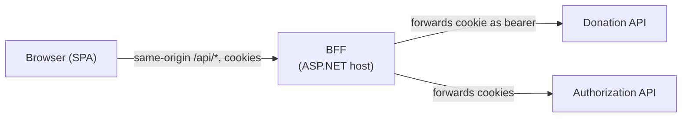

# Technical Architecture

Status: Target

This document describes how the new front-end is built and how it talks to the backend. The decision record is [ADR-012](../reference/adr/0012-react-spa-frontend.md).

---

## Stack

| Concern | Choice | Reason |
| --- | --- | --- |
| Runtime for tooling | Node 24 (LTS) | Pinned; see [Project setup](#project-setup) |
| Language | TypeScript 7, `strict` mode | Type safety against the generated API types; the native compiler keeps the type-check fast |
| Framework | React | Largest ecosystem for accessible component libraries and testing |
| Build tool | Vite | Fast dev server, simple configuration |
| Routing | React Router | Mature, supports route-level data loading |
| Server state | TanStack Query | Caching, retries, loading and error states for API calls |
| Forms | React Hook Form with Zod | Typed validation; map API `ProblemDetails` onto fields |
| API client | Generated from the OpenAPI snapshots | No hand-written DTOs; see below |
| Styling | CSS custom properties from [design-system.md](design-system.md), plus CSS Modules | No heavy UI framework; tokens stay the single source of truth |
| Linting | oxlint with the React, jsx-a11y, TypeScript, import and Vitest rules | Default linter of the Vite React template; accessibility rules built in |
| Unit and component tests | Vitest, Testing Library, axe | Fast feedback, accessibility checks included |
| E2E tests | Playwright (planned) | Journeys against the full stack |

Treat the choices as defaults. Replacing one is fine if the reason is recorded in the ADR.

## Where it lives

```text
src/
└── Frontend/
    └── TimeForCode.Frontend/        # the SPA (package.json, vite.config.ts)
        ├── src/
        │   ├── api/                 # generated clients (do not edit by hand)
        │   ├── app/                 # shell, routing, providers
        │   ├── components/          # design-system components
        │   ├── features/            # projects/, profile/, admin/, auth/
        │   ├── lib/                 # small helpers
        │   └── messages/            # all user-facing strings
        └── tests/                   # shared test setup and helpers (axe)
```

Organise by feature, not by file type. A feature folder owns its pages, queries, and tests. Shared building blocks go in `components/`.

## Project setup

Implemented in Phase 0 (#110); commands are in the project [README](../../src/Frontend/TimeForCode.Frontend/README.md).

- **Node version**: Node 24, pinned in `.nvmrc` and `package.json` `engines`. `.npmrc` sets `engine-strict`, so installing with another major version fails. CI reads `.nvmrc`.
- **Lock file**: `package-lock.json` is committed. CI installs with `npm ci --ignore-scripts`, so no package install scripts run. Dependency versions are pinned exactly.
- **Scripts**: `lint`, `typecheck`, `test:coverage` and `build` are the checks the pull request workflow runs. Lint warnings fail the check (`--deny-warnings`).
- **Coverage**: `test:coverage` writes `coverage/lcov.info` with paths relative to the repository root. The `frontend` CI job uploads it, and the .NET job passes it to SonarCloud (`sonar.javascript.lcov.reportPaths`). Test files, `tests/`, `src/main.tsx` and `vite.config.ts` are excluded from coverage.
- **Strictness**: `strict` and `noUncheckedIndexedAccess` are on. `tsc` is the native TypeScript 7 compiler; Vite and Vitest transpile without it, so only the type-check depends on it.
- **Accessibility tests**: component tests run axe through the small `axeViolations` helper in `tests/axe.ts` (axe-core directly, no wrapper library). jsdom cannot compute colour contrast, so contrast is checked in the E2E suite or by hand.

Choices that differ from the latest versions or the usual defaults, with the reason:

| Default | Chosen | Reason |
| --- | --- | --- |
| Latest jsdom (30) | jsdom 29 | jsdom 30 needs Node 24.15 or later; 29 supports every Node 24 release |
| ESLint | oxlint | The Vite React template ships oxlint; it has the React, hooks and jsx-a11y rules built in, while the ESLint jsx-a11y plugin does not support ESLint 10 yet |

## Authentication and the BFF

This is the most important design constraint. Read it before writing any code.

**Facts about the current backend** (verified in code):

- Login sets the access and refresh tokens as `HttpOnly`, `Secure`, `SameSite=Strict` cookies from the Authorization API.
- The cookie values are JSON documents, not bare JWTs.
- The Donation API validates only a **bearer token in the `Authorization` header**. It does not read cookies.
- Server-side code can bridge the two: `CookieAuthorizationHandler` (Shared) reads the cookie and attaches the bearer header, and `RefreshTokenForwardingHandler` forwards the refresh cookie when refreshing.
- [ADR-005](../reference/adr/0005-http-only-cookies.md) forbids tokens in JavaScript-accessible storage.

**Consequence**: a browser SPA cannot call the Donation API directly. JavaScript cannot read the HttpOnly cookie to build the bearer header, and a `SameSite=Strict` cookie will not be sent from a different site anyway.

A **BFF** (backend for frontend) is a small server that exists only to serve one front-end and sits between it and the backend APIs. An **SPA** (single-page application) is a website that loads once and then updates itself with JavaScript, fetching data from APIs.

**Decision (proposed)**: serve the SPA from, and call all APIs through, a thin **backend-for-frontend (BFF)** on the same origin. The BFF is a new, thin ASP.NET host that does only the following:

1. Serve the built SPA static files, with a fallback to `index.html` for client routes.
2. Reverse-proxy `/api/auth/*` to the Authorization API and `/api/donation/*` to the Donation API (for example with YARP), reusing the existing cookie-to-bearer and refresh-forwarding handlers.
3. Optionally render meta tags for public pages (see below).



The diagram shows that the browser only ever talks to one origin. The BFF translates cookies into bearer tokens so the backend APIs stay unchanged. Because everything is same-origin, the CORS configuration added for the admin flow is not needed for the SPA, and `SameSite=Strict` keeps working.

**When the BFF arrives** ([ADR-012 amendment](../reference/adr/0012-react-spa-frontend.md#amendment-2026-10-21-nginx-first-the-bff-with-sign-in), 2026-10-21): until sign-in, nginx serves the SPA and sets the security headers. The BFF is introduced with sign-in (#113), the first slice whose API calls need the cookie turned into a bearer header. The SPA only calls relative paths on its own origin, so it does not change when the BFF arrives:

| SPA path | Forwarded to | Until #113 | From #113 on |
| --- | --- | --- | --- |
| `/api/auth/*` | Authorization API `/api/*` | Not used | BFF |
| `/api/donation/*` | Donation API `/api/*` | nginx (added in #112) | BFF |

For example, `/api/donation/v1/Project` goes to the Donation API's `/api/v1/Project`.

Alternatives considered (recorded in the ADR): changing the Donation API to accept cookies (backend change, wider CSRF surface), or hosting the SPA on a sibling subdomain with a shared cookie domain (weakens `SameSite=Strict`). Both widen the scope of this work.

### CSRF

Cookie authentication means state-changing requests need CSRF protection. `SameSite=Strict` is the first layer. Add a second: the BFF requires a custom header (for example `X-Requested-With`) on `POST`, `PUT`, `PATCH`, and `DELETE`, which the generated client always sends. Note the decision in the ADR when implemented.

### Login redirect

Login starts with a browser navigation to the Authorization API login endpoint (through the BFF), which redirects to GitHub and back. The callback sets the cookies and redirects to the SPA. The allowed redirect targets are an allow-list in the Authorization API configuration; add the new front-end origin there. Never accept an arbitrary return URL.

### Session handling in the SPA

- Determine who is signed in with `GET /api/v1/User` on app start (cache with TanStack Query).
- On a 401, the API layer tries one refresh (`POST /api/v1/Authentication/refresh`), then retries the request once. If that fails, the user is treated as signed out.
- Roles for UI decisions come from the user endpoint or token claims exposed by the BFF. The backend remains the enforcer.

## API client generation

- Source of truth: the committed OpenAPI snapshots next to each API (see [ADR-007](../reference/adr/0007-swagger-snapshot-gate.md)).
- `npm run generate:api` generates `src/api/donation.d.ts` from the Donation snapshot with `openapi-typescript`. It runs through `npx` with exact versions of `openapi-typescript` and TypeScript 5, because `openapi-typescript` needs the JavaScript compiler API that the native TypeScript 7 compiler of this project does not have. The requests go through `openapi-fetch`, so request and response types come from the generated file only.
- **Decision (#112): the generated output is committed**, and CI fails when it is stale. `npm run check:api` regenerates it and fails on any `git diff` (step "API types up to date" in the `frontend` job). Committing keeps the Docker build free of files outside the front-end folder and shows API changes in the pull request diff.
- When a backend change alters a snapshot, `check:api` fails until the types are regenerated and committed; after that `typecheck` shows what the front-end must change. That is the contract gate for the front-end.
- The Authorization snapshot gets its own generated file when the first feature calls it (#113).
- The generated paths are the API's own (`/api/v1/Project`); `src/api/donationClient.ts` adds the `/api/donation` prefix of the front-end origin to each request.

## Dev server against the local stack

1. Start the stack: `scripts/start-local.ps1` (Donation API on `http://localhost:8082`).
2. In `src/Frontend/TimeForCode.Frontend`: `npm run dev` and open the printed URL.

`vite.config.ts` proxies `/api/donation/*` to `http://localhost:8082/api/*`, the same route nginx has in the image, so the SPA code is identical in both setups. The front-end container (`http://localhost:8084`) needs the Donation API container to be running.

## Rendering strategy

- Default: a client-rendered SPA.
- **Public pages** (`/`, `/projects`, `/projects/:id`) need good titles, descriptions, and Open Graph tags for sharing and search. The simplest start is for the BFF to inject per-route meta tags into `index.html` using the public API. Full server-side rendering or static prerendering is an upgrade if measurements show it is needed.
- **Open question**: decide when the first public page is built, and record it here.

## Configuration

- No environment-specific values in the build. The SPA uses relative `/api/...` URLs.
- Any runtime configuration (for example the repository URL for the footer) is served by the BFF as a small JSON endpoint.

## Build and deployment

- `Dockerfile.frontend` builds the SPA and serves it with nginx (`src/Frontend/nginx.conf`). `nginx.conf` is a template that the nginx image entrypoint renders with `envsubst` at start. The image build renders it the same way and runs `nginx -t`, so an invalid configuration fails the build, and then deletes the rendered file, so a container that cannot render the template at start fails instead of serving a stale build-time configuration. Deep links fall back to `index.html`; a missing file under `/assets/` returns 404.
- **Donation API route (#112)**: nginx forwards `GET` and `HEAD` requests for `/api/donation/*` to the Donation API's `/api/*` (other methods get 403 until the BFF of #113) (`/api/donation/v1/Project` becomes `/api/v1/Project`), so the browser only talks to the front-end origin and the Donation API needs no CORS. The upstream comes from `DONATION_API_UPSTREAM` (default `donation-api:8080`, set in `docker-compose.yaml`) and is used as a variable in `proxy_pass` with the container's DNS resolver (`NGINX_LOCAL_RESOLVERS`), so nginx resolves it per request. A literal hostname would make `nginx -t` fail at image build, where the compose network does not exist. Because of that variable nginx does not rewrite the API's `Location` headers by itself, so `proxy_redirect` maps `http://<upstream>/api/` back to `/api/donation/`; `X-Forwarded-For`, `-Host` and `-Proto` are sent for when the API reads them.
- When the BFF host is added (#113), either the BFF serves the SPA build output or nginx keeps serving it and forwards `/api/*` to the BFF. Decide in #113 and record it here.
- The front-end build, lint, type-check, and unit tests run in the `frontend` job of the pull request and main-branch workflows (`.github/workflows/`). The same job builds the front-end image from `Dockerfile.frontend`; it is not pushed until the front-end has a deployment. A failing check fails the job; on `main` it also blocks Release Please.
- `scripts/smoke-test.ps1` (section 5) checks the running front-end in the local stack: the SPA at `/` and on a deep link, a built asset, the 404 for a missing asset, the security headers on each of those responses, the forwarding route `/api/donation/v1/Project`, and that writes on it are refused.
- Target topology: one front-end container hosting the SPA. See [Deployment Status](../current/deployment-status.md).

## Testing strategy

| Level | Tooling | Scope |
| --- | --- | --- |
| Unit | Vitest | Helpers, mapping of API errors to form errors |
| Component | Testing Library, axe | Components and pages with a mocked API layer |
| E2E | Playwright (planned) | Journeys against the full stack; keep `data-testid` values |

Follow [testing-strategy](../current/testing.md) and ADR-008: E2E tests stay out of CI and run on demand.

## Security checklist

- No tokens in JavaScript-accessible storage; no tokens in URLs.
- Never render API-provided HTML. React escapes by default; do not use `dangerouslySetInnerHTML`.
- External links use `rel="noopener noreferrer"`.
- Security headers on every response, set by nginx (by the BFF if it takes over serving the files):
  - `Content-Security-Policy` that allows only the SPA's own origin and no framing: `default-src 'self'; object-src 'none'; base-uri 'self'; form-action 'self'; frame-ancestors 'none'`. No inline scripts or styles and no `data:` URLs; React's `style` prop is allowed because it sets styles from script. Allowing another source (for example GitHub avatars) is a deliberate change to `src/Frontend/nginx.conf` and to the smoke test's check.
  - `X-Content-Type-Options: nosniff`.
  - `Referrer-Policy: strict-origin-when-cross-origin`.
- Dependencies are pinned, and Dependabot or the existing dependency-update skill keeps them current.
