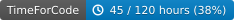

# Embeddable README badges: design

Design for issue #190, implemented in the Reporting API. The routes, texts, caching and status codes as built are in [api-surface](../current/api-surface.md#reporting-api); this page keeps the design and the example images.

## Example badges

| State | Badge |
| --- | --- |
| Project, hours received |  |
| Project, progress |  |
| Organization tier (Gold) |  |
| Organization tier (Silver) |  |
| Contributor tier (Bronze) |  |
| No badge yet |  |
| Not found |  |
| Unavailable |  |

The examples are illustrative output of the designed renderer; real widths come from its width table.

## Routes

A new `BadgeImageController` (not the existing JSON controllers: its error behaviour differs and it produces `image/svg+xml`), anonymous, `[EnableRateLimiting("public")]`, under `api/v1/reporting`:

| Badge | Route |
| --- | --- |
| Project, hours received | `GET project/{id}/badge/hours-received.svg` |
| Project, progress | `GET project/{id}/badge/progress.svg` |
| Donor organization, highest tier | `GET donororganization/{id}/badge.svg` |
| Contributor, highest tier | `GET contributor/{id}/badge.svg` |

The `{id}` parameter is a plain `string`. The `[ObjectId]` attribute and `[ApiController]` model validation are not used, because they answer a malformed id with a JSON problem body (400). The controller parses the id itself and renders "not found" instead.

## Layers

- **Application** decides what the badge says. A new query per badge type (`GetProjectBadgeQuery` with a kind, `GetOrganizationBadgeQuery`, `GetContributorBadgeQuery`) sends the existing summary or badges query through MediatR and returns a `BadgeContent`: a state (`Value`, `NoBadgeYet`, `NotFound`, `Unavailable`) plus the value text. Mapping failures lives here, so the controller never sees status codes:
  - malformed id, unknown or unpublished project (the Donation API answers 404 for both), unknown organization: `NotFound`.
  - unknown contributor: `NoBadgeYet`, the same result as a known contributor without badges (the identical-image requirement). Both paths produce the same `BadgeContent` before rendering, so the bytes and headers cannot differ.
  - Donation API failure (502) or an unexpected error: `Unavailable`.
- **Highest tier**: the badges returned by the existing handlers carry only a name and award date. The query reads the tiers (existing `GetBadgeTiersHandler` data) and takes the earned badge whose tier has the highest threshold for that recipient type. The tier list is not changed and the JSON endpoints stay as they are.
- **Api** only renders: `SvgBadgeRenderer` turns a `BadgeContent` into SVG and the controller adds the cache header.

Reading a badge awards newly earned badges as a side effect, exactly like the existing JSON endpoints (same `BadgeAwarder`), so the badge is never behind the JSON.

## Badge look

Flat shields.io style, height 20 px, left label "TimeForCode", right value:

| State | Icon | Right-hand text | Colour |
| --- | --- | --- | --- |
| Hours received | clock | `120 hours` | green `#4c1` |
| Progress | clock | `45 / 120 hours (38%)` | blue `#007ec6` |
| Tier | star in a ring | the tier name (`Gold`) | tier colour: Bronze `#cd7f32`, Silver `#a8a8a8`, Gold `#d4af37`, any other tier name blue `#007ec6` |
| No badge yet | dashed circle | `no badge yet` | grey `#9f9f9f` |
| Not found | question mark in a circle | `not found` | grey `#9f9f9f` |
| Unavailable | warning triangle | `unavailable` | orange `#fe7d37` |

Icons are drawn as SVG shapes (white, 12 px box, 6 px from the left edge of the value area), not emoji or text characters: emoji render differently per viewer, cannot be measured by the width table and are read aloud by screen readers. The icons are decorative, so the `aria-label` and `<title>` stay "label: value". The example images are at the top of this page.

The label background is `#555`, text is white at 11 px Verdana/sans-serif. The SVG has `role="img"`, an `aria-label` with label and value, and a `<title>`. No scripts, no external references, no fonts to load.

## Rendering

`SvgBadgeRenderer` builds the SVG with `XmlWriter`, so every text and attribute value is escaped and the output is always well-formed XML. The width of each half comes from a per-character width table for 11 px Verdana (with a fallback width for other characters), plus 10 px padding; the value half adds 16 px for the icon. Each icon is a small constant SVG fragment in the renderer, selected by the badge state. No identifier, name or login appears in the SVG: the only values are totals, a tier name and the fixed texts. The renderer is a pure function and is unit-tested with escaping, long and unusual tier names, and that every state draws its icon inside the value area.

## Caching and rate limiting

- `Cache-Control: public, max-age=300` for `Value`, `NoBadgeYet` and `NotFound` badges; `public, max-age=30` for `Unavailable`. Both lifetimes are configuration (`Badges:CacheSeconds`, `Badges:UnavailableCacheSeconds`) so they can be tuned without a release.
- Every state responds with `200` and `image/svg+xml`. Only the rate limiter answers `429` (no body, as today) and an unexpected pipeline failure may still produce a 500, which the controller avoids by catching and rendering `Unavailable`.
- No `ETag` in this issue; the max-age already shields the API from GitHub's image proxy.

## Test approach

- Unit: `SvgBadgeRenderer` (escaping, valid XML, widths, each state), the badge query handlers (every failure mapped to the right state, unknown contributor equals contributor without badges, highest tier selection).
- API tests: content type, `Cache-Control`, `429`, malformed id gives a not found badge, rate-limit policy is `public`.
- Specs: fakes for the Donation data source return 404 to express an unpublished or unknown project and fail to express "unavailable", which also gives the `The project is not published` step its meaning without a new "published" concept in Reporting.
- Swagger snapshot gains the four routes with the `image/svg+xml` response, reviewed with `swagger-snapshot-review`.
- Architecture tests: the new queries and renderer stay within the existing layer rules (renderer in the Api layer, queries in Application/Commands).

## Documentation and tooling

- `docs/target/api-contracts.md`, `docs/current/api-surface.md` and `docs/current/capability-status.md` gain the four routes, status codes and caching behaviour; the README and `docs/` get the "show your TimeForCode badge" section with one Markdown snippet per badge type, for example ``.
- The seeder `badge-tiers` scenario and the manual guide follow the issue's acceptance criteria unchanged.

## Risks and open points

- **Timing**: a known contributor without badges and an unknown contributor may differ in response time (one extra lookup). The result is identical, which meets the criterion; timing equalisation is out of scope.
- **Proxy range**: the existing `public` policy partitions by client address. Behind GitHub's image proxy many visitors share a few addresses, so the policy may throttle legitimate README views. Related to the open proxy-range debt; the cache header is the main protection, and a dedicated `badge` policy with a higher limit can be added if the smoke test shows throttling.

## Differences in the implementation

- The badge states are `HoursReceived`, `Progress`, `Tier`, `NoBadgeYet`, `NotFound` and `Unavailable`: the renderer needs to know which kind of value it draws to pick the icon and the colour.
- The controller does not catch unexpected exceptions: the application layer never catches generic exceptions, so a defect still answers `500` and a Donation API failure is the only case that renders "unavailable".
- A malformed identifier is rejected by a plain 24-hexadecimal-digit check, not a regular expression, because the end anchor of a .NET regular expression also accepts a trailing line feed.
